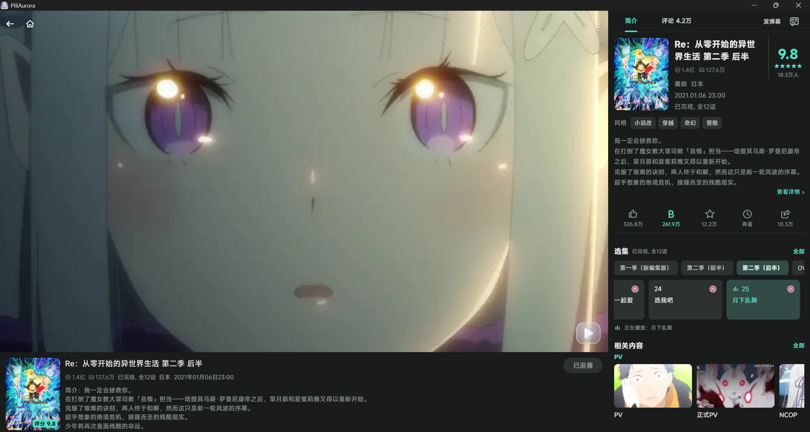
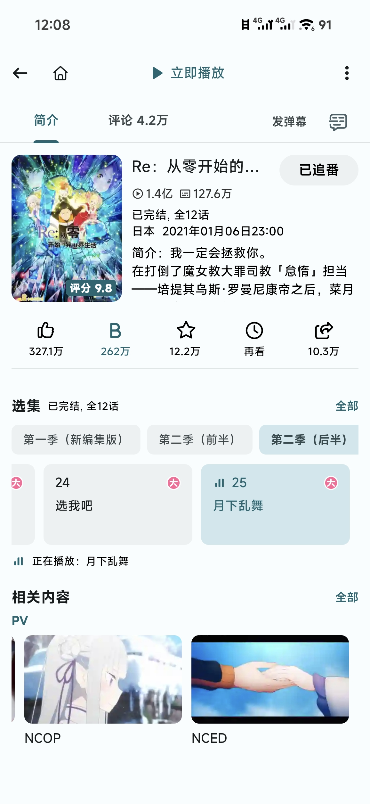

  <picture>
    <source media="(prefers-color-scheme: dark)" srcset="assets/images/logo/logo_chibi_dark.png">
    
  </picture>

# PiliAurora

[简体中文](README.md) · [English](README.en.md)

PiliAurora is a third-party Bilibili client for Android and Windows x64, built with Flutter and based on [PiliPlus 2.1.5](https://github.com/bggRGjQaUbCoE/PiliPlus/tree/2.1.5). It supports videos, series, live streams, activity feeds, direct messages, and offline downloads, with separate Windows playback windows, danmaku merging, and content filters. Danmaku are timed comments displayed over the video.

[Download](https://github.com/wallpap/PiliAurora/releases/latest) · [2.0.0 release notes](doc/releases/v2.0.0.md) · [User guides](doc/README.md#使用指南) · [Report an issue](https://github.com/wallpap/PiliAurora/issues)

## Supported platforms and downloads

Choose the package for your device from [GitHub Releases](https://github.com/wallpap/PiliAurora/releases/latest). Changes for 2.0.0 are described in the [release notes](doc/releases/v2.0.0.md); the Releases page lists the versions available to download.

| Device | Package |
| --- | --- |
| Android ARM64, including many recent phones and tablets | `arm64-v8a.apk` |
| Android 32-bit ARM | `armeabi-v7a.apk` |
| Android x86_64 device or matching emulator | `x86_64.apk` |
| Windows x64, with installation and shortcuts | `x64_setup.exe` |
| Windows x64, portable | Extract the complete `x64_portable.zip` and run `PiliAurora.exe` |

The in-app update check compares stable release version numbers and opens your browser to download an installer. Download prereleases manually from the Releases page.

For a Windows installer update, close the main window and playback windows, then install to the existing directory. For a portable update, extract the ZIP into a new directory. Accounts and settings remain in the Windows user data directory. Check the version in About after updating. If a pinned taskbar shortcut points to the old folder, unpin it and pin the updated app.

PiliAurora uses its own application identifier and data directory and can be installed alongside PiliPlus. Accounts, settings, caches, and offline files are stored separately. Release packages are available for Android and Windows x64.

## Features

| Use | Features |
| --- | --- |
| Browse | Recommendations, trending content, rankings, search, videos, series, articles, audio, live streams, and activity feeds |
| Watch | Video and audio quality, playback speed, subtitles, episodes, history, hardware decoding, and live-stream source selection |
| Windows playback windows | Pop out videos and live streams while browsing; move, resize, arrange, pin, and adjust each window's volume |
| Danmaku | Merge similar comments, enlarge repeated text, adjust track spacing and density-bar colors; follow the display on Windows, or follow the display or select 60/90/120 FPS on Android |
| Interact | Comments, following, followers, notifications, text and image messages, share cards, live-stream emotes, and sticker management |
| Organize | Multiple accounts, favorites, history, watch later, series subscriptions, offline downloads, and download audio quality |
| Filter and back up | Blacklist and collaboration-author filters, commenter levels, SponsorBlock, account and settings import/export, and WebDAV settings backups; DLNA casting and WebView are also supported |

Availability depends on Bilibili APIs, account permissions, platform, and the media. Performance varies with hardware, drivers, codec, quality, danmaku settings, and the number of windows.

## Common tasks

| Goal | How |
| --- | --- |
| Watch while browsing | On Windows, select the pop-out option in the player's playback-window menu. The new window takes over playback and sound when ready; you can open additional windows |
| Reduce repeated danmaku | Enable merging in playback settings or the player's danmaku panel. It takes effect immediately and is off by default; see the [matching rules](doc/guides/playback.md#弹幕合并与帧率) |
| Adjust video buffering | Select memory-saving, balanced, or smooth playback under video cache settings. Balanced is the default; changes apply on the next on-demand media load. Live streams use a separate policy |
| Hide blocked authors | Enhanced blacklist filtering and collaboration-author checks are on by default under account and privacy settings. Collaboration checks add requests and loading time and can be disabled separately |
| Filter comments by level | Set the minimum commenter level under content filtering, then refresh the comments. It is off by default; comments without user data remain visible |
| Back up or move devices | Follow the [backup guide](doc/guides/data-security.md). Local credentials and the WebDAV password are encrypted; backups require no extra password, so keep exported files private |

Version 2.0.0 fixes Windows playback going black after some reloads, failures with some large images, and old requests affecting actions after account or page changes. When an action's result is uncertain, refresh the relevant page to check before retrying. See the [release notes](doc/releases/v2.0.0.md) for changes and device-validation limits.

## User guides

The detailed guides and release notes are in Chinese.

- [Playback and danmaku](doc/guides/playback.md): windows, volume, buffering, merging, frame rates, and SponsorBlock.
- [Content and interactions](doc/guides/content.md): blacklist filtering, commenter levels, likes, menus, and stickers.
- [Accounts and backups](doc/guides/data-security.md): import, export, WebDAV, migration, and local data.
- [Troubleshooting](doc/maintenance/troubleshooting.md): common failures and diagnostics.

## Screenshots

### Windows

Pop out videos or live streams into separate windows while continuing to browse in the main window or watch other windows at the same time. The image shows several playback windows running side by side. Windows danmaku automatically follow the display refresh rate; their appearance can be adjusted in danmaku settings.

  
   
  <em>Windows multi-window playback</em>

  
   
  <em>Windows live-stream player</em>

  
   
  <em>Windows bangumi page</em>

### Android

  
   
  
  
  

## Development and contributions

To build from source or contribute, start with [Build and test](doc/development/build-and-test.md). Use the [feature map](doc/development/features.md) to find modules and the [2.0.0 release notes](doc/releases/v2.0.0.md#开发者) for developer and agent migration notes. The [documentation index](doc/README.md) links the remaining guides.

## Support the project

PiliAurora is free and open source. You can optionally support development and maintenance through Alipay or WeChat Pay.

  
  

## Reporting issues

Open a [GitHub issue](https://github.com/wallpap/PiliAurora/issues) with your operating system, device, app version, reproduction steps, and affected page. For playback issues, also include the video codec, quality, danmaku settings, and hardware-decoding state. Remove cookies, tokens, QR-code login information, and other account data before sharing logs.

For performance issues, enable performance recording under Settings → Logs and diagnostics, reproduce the issue, and export a diagnostic archive. Turn recording off afterwards; sampling and stored logs add overhead.

## Disclaimer

PiliAurora is an independently maintained community client and is not affiliated with or endorsed by Bilibili. It uses public APIs and does not provide cracked content. Please comply with Bilibili's terms of service and applicable laws. The Bilibili name, trademarks, and related content belong to their respective rights holders.

## Acknowledgments

- [PiliPlus](https://github.com/bggRGjQaUbCoE/PiliPlus): this project directly builds on version 2.1.5.
- [PiliPalaX](https://github.com/orz12/PiliPalaX) and [PiliPala](https://github.com/guozhigq/pilipala): upstream projects in the PiliPlus lineage.
- [My-Responsitories](https://github.com/My-Responsitories) and everyone who has contributed to the upstream projects and PiliAurora.
- The authors and maintainers of Flutter, media_kit, Dio, and other open-source dependencies.

Upstream source files retain their original copyright and license notices. Sources, copyrights, and licenses for dependencies and ported components are listed in [third_party/README.md](third_party/README.md) and the corresponding component files.

## License

PiliAurora is licensed under the [GNU General Public License v3.0](LICENSE). Third-party components retain their respective licenses.
