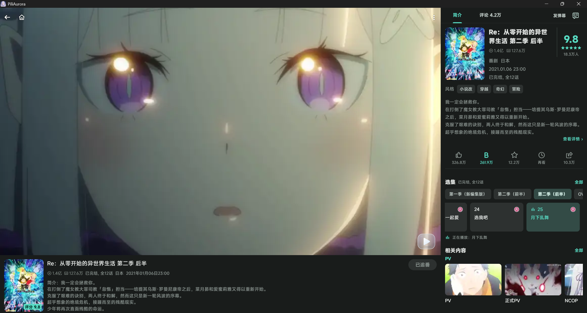

  <picture>
    <source media="(prefers-color-scheme: dark)" srcset="assets/images/logo/logo_chibi_dark.png">
    
  </picture>

# PiliAurora

[简体中文](README.md) · [English](README.en.md)

PiliAurora 是面向 Android 和 Windows x64 的 Bilibili 第三方客户端，基于 [PiliPlus 2.1.5](https://github.com/bggRGjQaUbCoE/PiliPlus/tree/2.1.5)，使用 Flutter 开发。支持视频、番剧、直播、动态、私信和离线下载，提供 Windows 独立播放窗口、弹幕合并与内容过滤。

[下载安装](https://github.com/wallpap/PiliAurora/releases/latest) · [2.0.1 更新说明](doc/releases/v2.0.1.md) · [使用指南](doc/README.md#使用指南) · [问题反馈](https://github.com/wallpap/PiliAurora/issues)

## 适配平台与下载

在 [GitHub Releases](https://github.com/wallpap/PiliAurora/releases/latest) 选择对应设备的安装包。2.0.1 的改动见[版本说明](doc/releases/v2.0.1.md)，已发布版本以 Releases 页面为准。

| 设备 | 选择的文件 |
| --- | --- |
| Android ARM64，常见的新款手机和平板 | `arm64-v8a.apk` |
| Android 32 位 ARM 设备 | `armeabi-v7a.apk` |
| Android x86_64 设备或对应模拟器 | `x86_64.apk` |
| Windows x64，需要安装和快捷方式 | `x64_setup.exe` |
| Windows x64，直接解压使用 | `x64_portable.zip`，完整解压后启动 `PiliAurora.exe` |

应用的“检查更新”比较正式发布的版本号，通过浏览器下载安装包；预发布版本从 Releases 页面手动下载。

Windows 安装版更新时，先退出主窗口和独立播放窗口，再安装到原目录。便携版将 ZIP 完整解压到新目录；账号和设置保存在 Windows 用户数据目录。更新后在“关于”核对版本，任务栏固定项若指向旧目录，可取消后从新版窗口重新固定。

PiliAurora 使用独立的应用标识和数据目录，可以与 PiliPlus 并存；两者的账号状态、设置、缓存和离线文件各自保存。目前提供 Android 和 Windows x64 发布包。

## 可以做什么

| 用途 | 功能 |
| --- | --- |
| 浏览内容 | 推荐、热门、排行榜、搜索、视频、番剧、专栏、音频、直播和动态 |
| 看视频与直播 | 清晰度、音质、倍速、字幕、分集、播放记录、硬件解码与直播线路选择 |
| Windows 多窗口 | 将视频或直播弹出为独立小窗，主窗口继续浏览；支持置顶、缩放、排列与各窗口音量 |
| 调整弹幕 | 合并相同或相似内容、按重复数放大字号、调整轨道间距和高能进度条颜色；Windows 自动跟随屏幕，Android 可选跟随屏幕或 60／90／120 FPS |
| 互动与消息 | 评论、关注、粉丝、通知、文字与图片私信、分享卡片、直播表情和原生表情包管理 |
| 管理内容 | 多账号、收藏夹、历史、稍后再看、番剧订阅、离线下载与下载音质选择 |
| 过滤与备份 | 黑名单和合作作者屏蔽、评论等级过滤、空降助手、账号与设置导入导出、WebDAV 设置备份；另支持 DLNA 投屏和 WebView |

功能受 Bilibili 接口、账号权限、平台和具体媒体资源影响。性能随设备、驱动、编码、清晰度、弹幕设置和窗口数量变化。

## 常用设置与操作

| 想要的效果 | 操作与生效时机 |
| --- | --- |
| 一边看一边浏览 | Windows 播放器顶部“播放窗口”菜单选择“弹出为独立小窗”；小窗准备好后接管播放与声音，可再打开其他小窗 |
| 减少重复弹幕 | 在播放设置或播放器弹幕面板开启“弹幕合并”，即时生效；默认关闭，匹配规则见[播放指南](doc/guides/playback.md#弹幕合并与帧率) |
| 调整视频预读 | “设置 → 播放设置 → 视频缓存策略”选择省内存、均衡或流畅优先，默认均衡，下次加载点播媒体时生效；直播使用独立策略 |
| 屏蔽不想看的作者 | “设置 → 账号与隐私”中的增强黑名单屏蔽与合作作者检查默认开启；合作作者检查会增加请求和加载时间，可单独关闭 |
| 按等级过滤评论 | “设置 → 内容与互动 → 内容过滤”选择最低评论用户等级，刷新评论区后生效；默认不屏蔽，缺少资料的评论保留 |
| 备份或换设备 | 使用[账号与设置备份](doc/guides/data-security.md)；本机凭证与 WebDAV 密码按字段加密，备份无需额外密码，导出文件仍需妥善保存 |

2.0.0 修复了 Windows 重载后可能黑屏、部分大图加载失败，以及切换账号或离开页面后旧请求仍影响当前操作的问题。保存、发送或修改资料时，如果提示“结果待确认”，先刷新对应页面核对结果，再决定是否重试。详细变化与设备验证范围见[2.0.0 发布说明](doc/releases/v2.0.0.md)。

## 使用指南

- [播放与弹幕](doc/guides/playback.md)：独立窗口、音量、缓存、合并与帧率、空降助手。
- [内容过滤与互动](doc/guides/content.md)：黑名单、评论等级、弹幕点赞、评论菜单与表情包。
- [账号与设置备份](doc/guides/data-security.md)：导入导出、WebDAV、跨设备恢复与本机数据。
- [维护与排障](doc/maintenance/troubleshooting.md)：常见故障与诊断记录。

## 界面预览

### Windows

多窗口播放可以弹出视频或直播小窗，并在主窗口继续浏览或者同时看另外的小窗，图中展示了多个小窗并行播放。Windows 弹幕自动跟随屏幕刷新节奏，显示效果可在弹幕设置中调整。

  
   
  <em>Windows 多窗口播放</em>

  
   
  <em>Windows 直播界面</em>

  
   
  <em>Windows 番剧界面</em>

### Android

  
   
  
  
  

## 开发与贡献

从源码运行或参与开发，请从[构建与测试](doc/development/build-and-test.md)开始；模块入口见[功能地图](doc/development/features.md)。开发者和 agent 的 2.0.0 迁移要点见[发布说明](doc/releases/v2.0.0.md#开发者)。完整导航见[项目文档](doc/README.md)。

## 赞助支持

PiliAurora 免费开源。你可以自愿通过支付宝或微信支付支持开发与维护。

  
  

## 问题反馈

请在 [GitHub Issues](https://github.com/wallpap/PiliAurora/issues) 提交问题，并附上系统、设备、应用版本、复现步骤和相关页面。播放问题请补充视频编码、清晰度、弹幕设置和硬件解码状态。分享日志前，请移除 Cookie、Token、二维码登录信息和其他账号数据。

需要排查性能时，可在“设置 → 日志与诊断”按需开启性能记录并导出诊断包，复现后关闭记录。记录会增加采样和存储开销。

## 声明

PiliAurora 是社区独立维护的第三方客户端，与 Bilibili 官方无隶属关系，也未获得其背书。项目使用公开接口，不提供破解内容。使用时请遵守 Bilibili 服务条款及适用法律。Bilibili 名称、商标及相关内容归其权利人所有。

## 致谢

- [PiliPlus](https://github.com/bggRGjQaUbCoE/PiliPlus)：本项目直接基于其 2.1.5 版本继续开发。
- [PiliPalaX](https://github.com/orz12/PiliPalaX) 与 [PiliPala](https://github.com/guozhigq/pilipala)：PiliPlus 的上游项目及历史来源。
- [My-Responsitories](https://github.com/My-Responsitories) 及所有为上游项目和 PiliAurora 作出贡献的开发者。
- Flutter、media_kit、Dio 及其他开源依赖的作者和维护者。

上游源码保留原有版权与许可声明。依赖和移植组件的来源、版权与许可证见 [`third_party/README.md`](third_party/README.md) 及对应组件文件。

## 许可证

本项目采用 [GNU General Public License v3.0](LICENSE)。第三方组件遵循各自的许可证。
