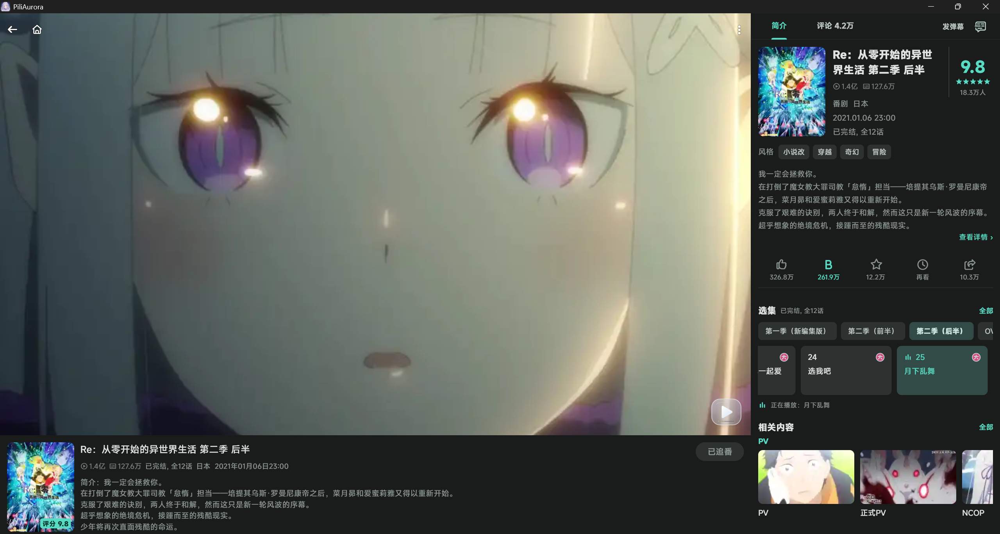

# PiliAurora

[简体中文](README.md) · [English](README.en.md)

[](https://github.com/wallpap/PiliAurora/releases/latest)
[](LICENSE)

PiliAurora 是面向 Android 和 Windows x64 的 Bilibili 第三方客户端，基于 [PiliPlus 2.1.5](https://github.com/bggRGjQaUbCoE/PiliPlus/tree/2.1.5)，使用 Flutter 开发。

在保留上游浏览、播放、互动和多账号功能的基础上，PiliAurora 集中优化播放时的资源占用，重做 Windows 弹幕渲染与视频输出，并加入视频和直播独立窗口、弹幕合并与帧率调节、原生表情包管理、番剧页面优化（接近官方效果）等功能。

[下载](https://github.com/wallpap/PiliAurora/releases/latest) · [更新日志](doc/releases/v1.6.0.md) · [问题反馈](https://github.com/wallpap/PiliAurora/issues) · [许可证](LICENSE)

## 界面预览

### Windows

多窗口播放可以弹出视频或直播小窗，并在主窗口继续浏览或者同时看另外的小窗，图中展示了多个小窗并行播放。Windows 弹幕自动跟随屏幕刷新节奏，显示效果可在弹幕设置中调整。

<p align="center">
  
  <br>
  <em>Windows 多窗口播放</em>
</p>

<p align="center">
  
  <br>
  <em>Windows 直播界面</em>
</p>

<p align="center">
  
  <br>
  <em>Windows 番剧界面</em>
</p>

### Android

<p align="center">
  
  </br>
  
  
  
</p>

## 适配平台与下载

| 平台 | 发布包 |
| --- | --- |
| Android | `arm64-v8a`、`armeabi-v7a`、`x86_64` 分 ABI APK |
| Windows x64 | 便携包、安装程序 |

从 [GitHub Releases](https://github.com/wallpap/PiliAurora/releases/latest) 下载对应平台的安装包。

## 相较于 PiliPlus 2.1.5 的改进

### Windows 多窗口播放

视频和直播可以弹出为多个独立窗口，一边看视频或直播，一边在主窗口继续浏览。播放窗口支持置顶、拖动、缩放、网格和层叠排列，记住上次的位置与大小；各窗口可分别调节音量，也可切换声音来源。使用方式见[Windows 独立播放窗口](doc/windows-playback-windows.md)。

### 降低播放与弹幕的资源开销

Windows 播放优先使用 D3D11 硬件解码和共享纹理输出，视频输出尺寸按显示区域限制，减少渲染表面和纹理开销。快速切源复用播放器资源，图片解码限制并发，隐藏页签卸载图片并保留滚动位置，减少后台页面占用。

Android 和 Windows 的视频与直播弹幕共用显示实现，分别按媒体时间和累计显示运行时间推进，复用文字布局、轨迹和栅格图片，减少逐帧重复计算；匹配与合并放到后台处理，缓存和活动工作集都有容量限制。直播复用后台消息解析 worker，并限制聊天历史和未读积压，控制长时间播放时的资源累积。

### 弹幕合并与帧率调节

视频弹幕可合并 20 秒内相同或相似的内容，并按重复数量放大字号。Windows 弹幕自动跟随屏幕刷新节奏；Android 可跟随屏幕，或选择 30、60、90、120 FPS，调整后即时生效。轨道间距按实际文字高度分配，高能进度条也可自定义颜色。设置说明见[弹幕合并与帧率设置](doc/danmaku-merge.md)。

### 播放稳定性修复

视频和直播统一管理播放会话，切换内容时隔离旧请求与回调。Android 在解码前准备视频 Surface，Windows 独立窗口在稳定纹理出现后再交接。读取中断时根据媒体和缓冲状态尝试恢复，可按需启用备用 CDN；硬件解码失败时会尝试其他路径。

Android 另有按屏幕分辨率缩放输出的实验选项，默认关闭。输出尺寸限制减少的是渲染开销，源视频仍按原分辨率解码；实际资源占用和流畅度随设备、驱动、编码、清晰度、弹幕设置及窗口数量变化。

### 消息与私信重构

主页和消息入口共享未读状态，回复、@、点赞、系统通知和私信跟随主账号。切换账号后丢弃旧账号的在途响应，会话操作同步共享状态，聊天历史去重，过期分页结果失效。

私信支持文本、图片和分享卡片。卡片与附言共用发送锁，分别反馈结果；发送结果待确认时保留草稿，并提示核对聊天记录。业务实现见[消息模块说明](lib/services/messaging/README.md)。

### 黑名单屏蔽

“设置 → 账号与隐私”中的“增强黑名单屏蔽”默认开启，在推荐、热门、搜索、动态和直播等列表中过滤已拉黑作者。“检查合作视频作者”也默认开启，列表已标识的合作视频中，任一作者被拉黑即屏蔽整条视频。合作作者查询会增加请求量和加载时间，可单独关闭。适用范围见[信息流黑名单屏蔽](doc/content-filtering.md)。

### 日常功能补充

- 原生表情包管理，支持分类添加、移除、内容预览和单个表情放大，并记录最近使用的表情。
- 评论长按菜单支持拉黑用户，新增粉丝列表支持直接关注和取消关注。
- 下载可选择音质，分集之间继承字幕状态，支持清理失效番剧订阅。
- 直播弹幕支持表情，表情包页签和收藏文件夹支持鼠标滚轮操作。
- 番剧页面优化，在piliplus的基础上增加了便捷切季，以及更多番剧相关内容的显示，让其更接近官方体验。

## 与上游的关系

PiliAurora 从 PiliPlus 2.1.5 开始独立维护，当前发布 Android 和 Windows x64 版本；上游基线列出的平台还包括 iOS、Pad 和 Linux。PiliAurora 使用独立的应用标识和数据目录，可以与 PiliPlus 并存，账号状态、设置、缓存和离线文件各自保存。

## 功能概览

- 内容浏览：首页推荐、热门、排行榜、视频、番剧、文章、音频、直播和搜索。
- 播放：清晰度和音质选择、播放速度、硬件解码设置、弹幕、字幕、分集切换和播放记录。分集间可继承字幕状态，高能进度条支持自定义颜色。
- 互动：评论、动态、关注、粉丝、消息通知、私信和直播聊天，直播弹幕支持表情。
- 评论长按菜单支持拉黑用户；表情包可按分类添加、移除和预览，详见[评论与表情包](doc/comments-and-emotes.md)。
- 账号与内容管理：多账号、收藏夹、观看历史、稍后再看、番剧订阅和离线下载。支持清理失效番剧订阅、选择下载音质。
- 扩展能力：DLNA 投屏、WebDAV 设置备份、SponsorBlock 和 WebView。

功能受 Bilibili 接口、账号权限、平台和具体媒体资源影响。

## 从源码构建

项目使用 [.fvmrc](.fvmrc) 固定 Flutter 版本。Android 构建需要 Android SDK 和 JDK 25；Windows 构建需要启用了“使用 C++ 的桌面开发”工作负载的 Visual Studio。Windows 使用仓库内的 [mpv 预编译包](third_party/mpv/README.md)，本地构建和 GitHub Windows CI 都会校验并解压；更新原生库时可从固定源码重建。环境要求与验证命令见[构建与测试](doc/build-and-test.md)。

```powershell
git clone https://github.com/wallpap/PiliAurora.git
cd PiliAurora
fvm install
pwsh -File tool/build.ps1 -Platform windows -Mode debug
pwsh -File tool/build.ps1 -Platform android -Mode debug
```

## 项目文档

使用说明、开发指南和版本记录见[文档索引](doc/README.md)。

- 使用：[弹幕设置](doc/danmaku-merge.md)、[Windows 独立播放窗口](doc/windows-playback-windows.md)。
- 开发：[构建与测试](doc/build-and-test.md)、[功能领域地图](doc/features.md)、[架构](doc/architecture.md)。
- 排障：[维护指南](doc/maintenance.md)、[Windows 视频输出](doc/windows-video-output.md)、[消息模块](lib/services/messaging/README.md)。

## 参与贡献

欢迎通过 GitHub Issues 报告问题或提交 Pull Request。修改播放器、弹幕或平台代码前，请阅读[维护与排障](doc/maintenance.md)和[构建与测试](doc/build-and-test.md)；修改第三方依赖时，请按[依赖维护说明](third_party/README.md)登记来源和许可证。

## 问题反馈

请在 [GitHub Issues](https://github.com/wallpap/PiliAurora/issues) 提交问题，并附上系统、设备、应用版本、复现步骤和相关页面。播放问题请补充视频编码、清晰度、弹幕设置和硬件解码状态。分享日志前，请移除 Cookie、Token、二维码登录信息和其他账号数据。

## 声明

PiliAurora 是社区独立维护的第三方客户端，与 Bilibili 官方无隶属关系，也未获得其背书。项目使用公开接口，不提供破解内容。使用时请遵守 Bilibili 服务条款及适用法律。Bilibili 名称、商标及相关内容归其权利人所有。

## 致谢

- [PiliPlus](https://github.com/bggRGjQaUbCoE/PiliPlus)：本项目直接基于其 2.1.5 版本继续开发。
- [PiliPalaX](https://github.com/orz12/PiliPalaX) 与 [PiliPala](https://github.com/guozhigq/pilipala)：PiliPlus 的上游项目及历史来源。
- [My-Responsitories](https://github.com/My-Responsitories) 及所有为上游项目和 PiliAurora 作出贡献的开发者。
- Flutter、media_kit、Dio 及其他开源依赖的作者和维护者。

上游源码保留原有版权与许可声明。依赖和移植组件的来源、版权与许可证见 [`third_party/README.md`](third_party/README.md) 及对应组件文件。

## 许可证

本项目采用 [GNU General Public License v3.0](LICENSE)。第三方组件遵循各自的许可证。
