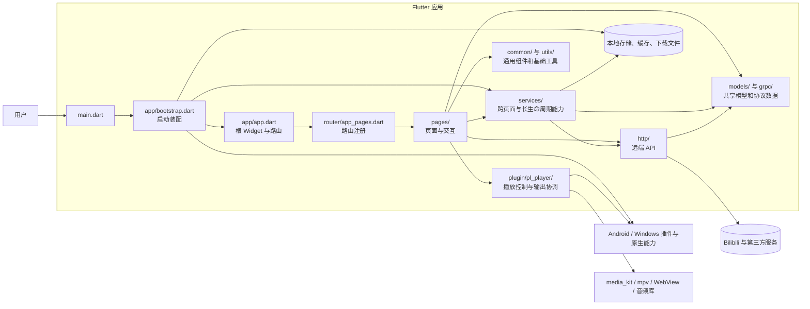

# 架构概览

应用由 Flutter 客户端、平台插件、远端服务和本地数据组成。图中箭头表示常见调用方向。

## 系统边界

应用没有配套服务端。网络访问、平台插件和本地文件系统都是应用边界；Android 与 Windows 共用大部分 Dart 页面和服务，但窗口、WebView、媒体输出和解码路径有平台差异。

## 目录职责

| 目录 | 主要职责 | 修改时先看 |
| --- | --- | --- |
| `lib/app/` | 启动装配、路径准备、平台初始化、根 Widget 与返回导航 | `bootstrap.dart`、`platform_setup.dart`、`app.dart` |
| `lib/router/` | 集中注册 GetX 路由及页面入口 | `app_pages.dart` 与页面构造参数 |
| `lib/pages/` | 按用户功能组织 view、controller 和局部组件 | 路由、controller、对应测试 |
| `lib/http/` | 业务 API 与请求层横切逻辑 | API 调用方、响应模型、`init.dart` |
| `lib/services/` | 下载、直播流、账号、诊断等跨页面或长生命周期能力 | 生命周期、资源所有者、对应测试 |
| `lib/models/`、`lib/grpc/` | API 模型、共享数据、枚举及 gRPC/protobuf 数据 | 上游定义和生成流程 |
| `lib/plugin/pl_player/` | 播放状态、媒体源、弹幕、原生输出和全屏控制 | `controller.dart`、对应平台实现和测试 |
| `lib/common/`、`lib/utils/` | 通用 UI、存储、缓存、平台判断及辅助逻辑 | 全部调用方，避免把页面状态放进通用层 |
| `android/`、`windows/`、`third_party/` | 平台工程、插件和本地维护的依赖实现 | 依赖登记、生成脚本和平台构建配置 |

部分页面 controller 直接调用 `http/`，另一些经由 `services/`。`models/` 同时包含远端响应和页面间共享对象，不等同于数据库实体。

## 关键边界与约束

- `main.dart` 只进入 `bootstrapApplication()`。启动依赖顺序和服务装配集中在 `app/bootstrap.dart`；平台初始化在 `app/platform_setup.dart`。
- `app_pages.dart` 是路由注册表。新增或移动页面时同步检查路由名、构造参数、返回栈和 deep link 调用方。
- `services/` 负责跨页面共享或需显式管理生命周期的工作。页面状态通常留在对应 controller。
- `DownloadRepository` 负责下载目录布局和记录读写；`DownloadService` 负责队列、状态和任务调度；`DownloadManager` 负责单路媒体传输。详情见[下载流程](runtime-flows.md#下载)。
- `DownloadRepository.load()` 跳过损坏的单条记录并通过回调报告；写入在进入串行队列前编码数据快照。它是文件存储，不提供事务或崩溃原子性。
- `pl_player/` 是项目与 `media_kit`、mpv 及平台输出之间的协调层。`PlPlayerController` 保留交互、可观察状态和事件接线；`playback/` 管理页面借用、查询有效性、串行加载、原生资源与网络恢复。平台渲染行为仍需在目标设备验证。
- `PlaybackSession` 与网络恢复模块通过操作及状态回调连接调用者，不依赖 GetX、页面、HTTP 或全局设置。`NativePlaybackRuntime` 集中处理原生初始化、平台配置与资源释放；点播来源选择集中在 `pages/video/playback_source.dart`。
- 播放状态区分用户的播放意图与原生加载过程中的短暂暂停。切画质、音质和网络恢复沿用播放意图；字幕等媒体附属请求提交前检查当前媒体与页面归属。
- 快速切源共享一套 Player、VideoController、事件订阅和纹理输出。会话协调发生在查询、切源和恢复路径，不新增每帧状态广播；过期排队加载跳过原生操作。
- protobuf 与 Android JNI 属于生成产物。修改源定义或生成脚本，再运行项目生成流程；不要直接维护生成文件。
- 定制依赖通过 `dependency_overrides` 指向 fork 或仓库目录。来源、版本和许可证以 `pubspec.yaml`、`pubspec.lock` 与 [`third_party/README.md`](../third_party/README.md) 为准。

`test/architecture/dependency_rules_test.dart` 断言 `main.dart` 不被导入、`app/` 不被底层模块依赖；也检查下载仓库不依赖 UI、GetX、网络或全局存储，以及下载执行器通过构造参数接收 Dio。

## 状态与本地数据

| 数据 | 所有者/入口 | 说明 |
| --- | --- | --- |
| 设置与本地 box | `GStorage`、`Pref`、`SettingBoxKey` | 存储初始化在启动阶段完成；新增设置时同步默认值和键定义。 |
| 下载记录与媒体索引 | `DownloadRepository` | 文件位于下载根目录；目录格式与 JSON 字段由仓库维护。 |
| 临时目录、缓存、字体 | `app/app_paths.dart`、`CacheManager`、`FontUtils` | 初始化先于页面使用。 |
| 诊断记录 | `services/diagnostics/`、`DiagnosticReportHandler` | 记录会按设置脱敏；导出前仍应确认没有账号凭据。 |
| 播放器状态 | `PlaybackSession`、`NativePlaybackRuntime` 与 `PlPlayerController` | 会话拥有页面归属与加载代次，运行时拥有原生资源，控制器负责 UI 状态与事件接线。 |

## 平台边界

| 平台 | 主要代码 | 需单独确认的行为 |
| --- | --- | --- |
| Android | `android/`、JNI helper、`pl_player/utils/android_*` | MediaCodec、Surface 生命周期、旋转、系统栏和音频输出 |
| Windows | `windows/`、窗口管理、Windows WebView 与媒体输出代码 | 窗口尺寸/DPI、WebView 环境、GPU 解码、纹理尺寸和弹幕渲染 |

工具链和平台构建要求见[构建与测试](build-and-test.md)；运行时调用时序见[运行流程图](runtime-flows.md)。
