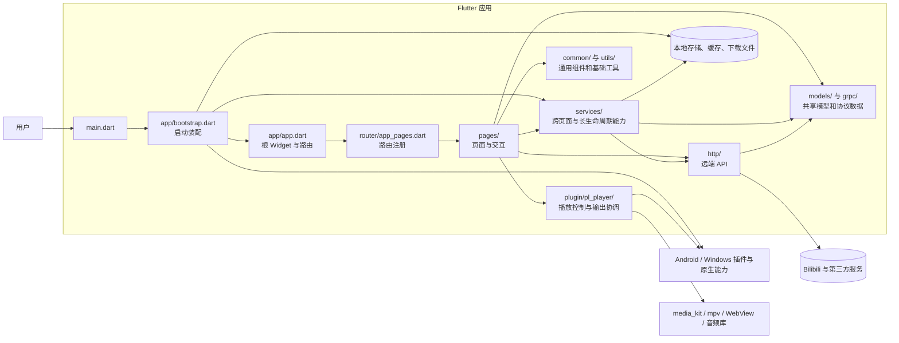
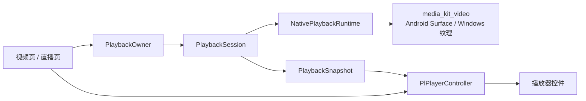

# 架构概览

播放器、弹幕显示和帧调度的分层图与交互时序见[详细架构图](diagrams/README.md)。

应用由 Flutter 客户端、平台插件、远端服务和本地数据组成。图中箭头表示常见调用方向。

## 系统边界

应用没有配套服务端。网络访问、平台插件和本地文件系统都是应用边界；Android 与 Windows 共用大部分 Dart 页面和服务，但窗口、WebView、媒体输出和解码路径有平台差异。

## 目录职责

| 目录 | 主要职责 | 修改时先看 |
| --- | --- | --- |
| `lib/app/` | 启动装配、路径准备、平台初始化、根 Widget 与返回导航 | `bootstrap.dart`、`platform_setup.dart`、`app.dart` |
| `lib/router/` | 集中注册 GetX 路由及页面入口 | `app_pages.dart` 与页面构造参数 |
| `lib/pages/` | 按用户功能组织 view、controller 和局部组件 | 路由、controller、对应测试 |
| `lib/http/` | 业务 API 与请求层横切逻辑 | API 调用方、响应模型、`init.dart` |
| `lib/services/` | 下载、消息、直播流、账号、诊断等跨页面或长生命周期能力 | 生命周期、资源所有者、对应测试 |
| `lib/models/`、`lib/grpc/` | API 模型、共享数据、枚举及 gRPC/protobuf 数据 | 上游定义和生成流程 |
| `lib/plugin/pl_player/` | 播放状态、媒体源、弹幕、原生输出和全屏控制 | `controller.dart`、对应平台实现和测试 |
| `lib/common/`、`lib/utils/` | 通用 UI、存储、缓存、平台判断及辅助逻辑 | 全部调用方，避免把页面状态放进通用层 |
| `android/`、`windows/`、`third_party/` | 平台工程、插件和本地维护的依赖实现 | 依赖登记、生成脚本和平台构建配置 |

部分页面 controller 直接调用 `http/`，另一些经由 `services/`。`models/` 同时包含远端响应和页面间共享对象，用途比数据库实体更宽。

## 播放统一架构

点播视频和直播共用一套播放协议。页面只拥有业务计划和页面副作用；播放状态、原生操作与输出资源分别由 owner、会话和运行时持有。

| 层 | 主要入口 | 职责 | 不应承担 |
| --- | --- | --- | --- |
| 页面 | `pages/video/`、`pages/live_room/` | 生成业务内容键，解析地址和媒体候选，装配 `PlaybackPlan`，处理字幕、历史和弹幕等页面副作用 | 直接调度原生加载、把 URL 当作内容身份 |
| 页面所有者 | `PlaybackOwner` | 表达页面控制权，提交查询、加载和控制命令，持有页面 inhibitor 与 keepalive 租约 | 跨页面保存原生资源 |
| 播放会话 | `PlaybackSession` | 接受请求代次，提交不可变计划，合并播放意图与配置，执行来源故障切换、命令串行化和状态快照发布 | 构建控件、发起业务 HTTP 请求 |
| 原生运行时 | `NativePlaybackRuntime` | 创建和释放 Player/VideoController，校验原生事件身份，准备输出、首帧和几何，串行执行已接受的原生操作 | 判断页面业务归属 |
| UI 门面 | `PlPlayerController` | 把快照投影到现有控件状态，转发页面命令，保留播放器外观与业务适配 | 成为播放状态或原生输出的第二所有者 |
| 平台输出 | `media_kit_video` 及 `third_party/` 适配 | 管理 Surface/纹理、输出代次、尺寸提交、帧交接和释放回执 | 推断视频业务身份 |

关键约束：

- `PlaybackPlan` 冻结业务内容键、来源候选索引、时间线、位置和已捕获配置。内容键表示视频、分集或直播间，来源地址只表示当前候选。
- 查询绑定 requestId 与 owner；加载和命令继续绑定 loadId。失去控制权的 owner 不能提交新操作；已发出的原生操作可以完成，但返回值只有代次仍匹配时才进入规范状态。
- `PlaybackSnapshot` 区分用户意图、原生实际状态和 inhibitor。命令成功只表示原生写入被接受，不能据此推断播放器实际已播放、暂停或缓冲。
- 原生事件、输出挂载和释放回执都必须匹配当前 runtimeId、loadId 与 outputEpoch。迟到的结果不能覆盖新加载或新输出。
- 页面关闭先停止接受命令，再排空已接受操作、卸载媒体、释放输出并销毁 Player。跨控制器运行时槽等待 `Player.released` 后才允许下一次初始化。
- Windows 独立播放窗口拥有自己的 Flutter 进程、Player、输出和缓存；主窗口只负责启动、排列、声音切换、设置快照和离线进度回写。

统一协议的回归入口见 `test/plugin/pl_player/playback/`，其中 `playback_session_test.dart` 覆盖代次、意图、配置和故障切换，`player_architecture_acceptance_test.dart` 覆盖 deadline、owner 与资源释放。设备侧加载、暂停、首帧和释放协议见 [`session_device_acceptance.dart`](../tool/probes/playback/session_device_acceptance.dart)、[`paused_output_attach.dart`](../tool/probes/playback/paused_output_attach.dart) 和 [`session_paused_load.dart`](../tool/probes/playback/session_paused_load.dart)。

## 关键边界与约束

- `main.dart` 只进入 `bootstrapApplication()`。启动依赖顺序和服务装配集中在 `app/bootstrap.dart`；平台初始化在 `app/platform_setup.dart`。
- `app_pages.dart` 是路由注册表。新增或移动页面时同步检查路由名、构造参数、返回栈和 deep link 调用方。
- `services/` 负责跨页面共享或需显式管理生命周期的工作。页面状态通常留在对应 controller。
- `services/messaging/` 按主账号的 `MessagingSession` 管理消息业务。GetX 保留路由，Riverpod 订阅业务快照；聊天和分享共用会话缓存及发送锁。分类消息句柄由页面 Notifier 创建和释放，未读概览、会话列表及聊天缓存由 Session 持有。入口和异步约定见[消息模块](../lib/services/messaging/README.md)。
- `DownloadRepository` 负责下载目录布局和记录读写；`DownloadService` 负责队列、状态和任务调度；`DownloadManager` 负责单路媒体传输。详情见[下载流程](runtime-flows.md#下载)。
- `DownloadRepository` 写入前编码快照，同目录临时文件 flush/close 后重命名替换，并保留上次可读 JSON 的 `.bak`。启动按正式文件、备份、临时文件顺序恢复记录与媒体索引，读取或恢复失败通过回调报告；Windows 文件占用时不删除正式文件重试。它不提供跨文件事务，也不承诺断电时目录项持久性；进程中断后的续传进度以实际媒体文件长度为准。
- `pl_player/` 是项目与 `media_kit`、mpv 及平台输出之间的协调层。`PlPlayerController` 负责 UI 投影、业务事件和平台适配；页面通过 `PlaybackOwner` 提交查询、加载与控制命令，`PlaybackSession` 管理页面归属、播放意图、配置快照和原生操作顺序。
- 每个 `PlaybackPlan` 冻结业务内容键、来源候选及索引、时间线、位置和加载配置。查询在队列外解析，但 owner 在开始时同步接受请求代次与播放策略，再由会话提交解析出的计划；来源地址不承担内容身份。偏好只在装配计划或创建运行时配置时读取。
- `PlaybackSnapshot` 是播放状态和配置的规范投影。页面控制器将其投影到现有 UI 状态；进度和视频帧仍走专用通道。页面保留字幕请求、直播消息和弹幕等业务副作用，并在异步提交时核对媒体与页面归属。
- `NativePlaybackRuntime` 集中处理 Player/VideoController 初始化、原生配置和释放。跨控制器的运行时槽在旧 Player 的 `released` 完成前不允许创建新 Player；显式后台媒体租约可让页面 owner 关闭后继续播放。最后一个 owner 和租约释放后才开始会话关闭。
- 播放状态区分用户意图、原生实际状态和会话 inhibitor。切画质、音轨、倍速、音量、shader 与网络恢复通过 owner 命令协调；页面路由、后台和音频焦点只释放自己持有的 inhibitor，不重写用户暂停意图。
- 快速切源共享一套 Player、VideoController、事件订阅和纹理输出。过期请求在进入原生操作前被跳过；原生已发出的操作保留在运行时串行链中，并在返回后核对请求代次。
- Windows 独立播放窗口由 `DesktopPlaybackWindows` 启动子进程，通过本地连接接收播放请求、账号与设置快照。每个窗口有自己的 Flutter、播放器和缓存目录；窗口内的设置保存在内存中，主窗口负责排列、位置保存与离线进度回写。
- Windows 超分更新通过会话 shader 配置槽串行化，必要时重建原生渲染器；播放器释放等待已接受的原生操作结束。原生资源释放顺序见[Windows 视频输出](windows-video-output.md)。
- protobuf 与 Android JNI 属于生成产物。修改源定义或生成脚本，再运行项目生成流程；不要直接维护生成文件。
- 定制依赖通过 `dependency_overrides` 指向 `third_party/` 中的本地包。来源、版本和许可证以 `pubspec.yaml`、`pubspec.lock` 与 [`third_party/README.md`](../third_party/README.md) 为准。

`test/architecture/dependency_rules_test.dart` 断言 `main.dart` 不被导入、`app/` 不被底层模块依赖；也检查下载仓库不依赖 UI、GetX、网络或全局存储，以及下载执行器通过构造参数接收 Dio。

## 状态与本地数据

| 数据 | 所有者/入口 | 说明 |
| --- | --- | --- |
| 设置与本地 box | `GStorage`、`Pref`、`SettingBoxKey` | 存储初始化在启动阶段完成；新增设置时同步默认值和键定义。 |
| 下载记录与媒体索引 | `DownloadRepository` | 文件位于下载根目录；目录格式与 JSON 字段由仓库维护。 |
| 临时目录、缓存、字体 | `app/app_paths.dart`、`CacheManager`、`FontUtils` | 初始化先于页面使用。 |
| 诊断记录 | `services/diagnostics/`、`DiagnosticReportHandler` | 记录会按设置脱敏；导出前仍应确认没有账号凭据。 |
| 播放器状态 | `PlaybackSession`、`PlaybackOwner`、`NativePlaybackRuntime` 与 `PlPlayerController` | 会话快照是规范状态；owner 表达页面控制权，运行时拥有原生资源，控制器负责 UI 投影和业务适配。 |
| 消息状态 | `MessagingSession`、业务句柄与 Riverpod provider | 根 Widget 提供 `ProviderScope`；切换主账号时释放旧 Session，订阅重建。消息列表、聊天缓存和未读快照保存在内存中。 |

## 弹幕显示与来源

`NativePlaybackRuntime` 持有只读 `PlaybackFrameSource`，按输出 token、平台采样代次、阶段和批次序号隔离高频视频采样。Android 请求采样经监听注册与新 buffer 关联确认；纹理消费继续独立用于首帧和播放健康。暂停、缓冲、seek 和输出重配关闭相位准入，恢复条件成立且取得新帧确认后开启新代次。

点播、直播各持有一份 `DanmakuFrameScheduler`，集中管理所属视图、视频采样订阅、连续更新与一次性刷新。显示值变化清除旧相位和待匹配帧；同一 Flutter 帧合并一次更新。位置使用帧目标时间，候选年龄和期限使用回调开始的单调时间。启动装配的呈现配置与自编引擎身份对应，构建入口见[引擎协议](../tool/engine/README.md)。

点播显示通过 `PlaybackMediaClock` 读取不可变的 `PlaybackMediaAnchor`，独立于低频播放快照。锚点包含媒体位置、进程单调时间、实际速率、推进状态、连续性标识和有效期；外推到有效期末端后停止。原生属性由 `native_media_clock_worker.dart` 在后台 isolate 读取，`NativeMediaClockSampling` 合并在途通知；运行时在发布前核对 Player、加载绑定、seek 序号和连续性，释放 Player 前等待读取退出。暂停、缓冲和倍速变化对应的锚点更新与 seek 确认流程见[运行流程](runtime-flows.md#媒体时钟与跳转确认)。

`PlDanmaku`装配业务范围来源、只读媒体时钟和显示配置；`LiveDanmaku`装配房间规范消息和运行状态。显示实现共用`DanmakuWindowRenderer`，普通轨迹、跨轨准入、数量和命中规则来自`canvas_danmaku`的共享几何。绘制读取生效工作集，更新阶段管理位置、到期、选择及图片引用。

点播协调器按有界100ms桶样本准备滑动窗口，实际倍速调整媒体锚点与前瞻量。直播候选保留传输入口的单调收到时间，运动时间累计显示运行时段；候选年龄与资源期限在暂停期间继续推进。隐藏解除直播显示订阅，聊天和SC由房间继续消费。

页面通过`DanmakuDisplayBinding`和只读交互快照进行选择、列表、清屏和来源回显。轨道、活动项和图片保留在显示实例。来源替换、seek和卸载结束旧选择；局部来源失效按条目原始时间撤回受影响项，保留无关活动轨迹、图片与选择。显示配置按小批次准备，轨迹、资源和命中在同一帧生效。点播范围来源的过滤/合并更新先通知失效，再提交最新规则结果。

来源解码和合并共用进程级`DanmakuWorkQuota`，运行任务实际退出后归还额度。解析前检查单条编码与字段数量，后续处理沿同一预留核对批次、合并上下文、规则和结果占用；原始缓存与处理结果缓存分别限制字节。范围覆盖区分未加载、加载中、失败、失效及已加载。

本地文件通过外部稳定排序和持续合并游标处理，内存缓存保留当前所需分段。排序产物由来源持有，范围与规则变化复用它；原文件路径、长度或文件时间变化时重建，来源释放等待当前读取退出后清理。显示实例持有表情源图引用，源图、栅格、候选及在途图片预留共用实例工作集，图片按共享 backing 计账。

## 平台边界

| 平台 | 主要代码 | 需单独确认的行为 |
| --- | --- | --- |
| Android | `android/`、JNI helper、`pl_player/utils/android_*` | MediaCodec、Surface 生命周期、旋转、系统栏和音频输出 |
| Windows | `windows/`、窗口管理、Windows WebView 与媒体输出代码 | 窗口尺寸/DPI、WebView 环境、GPU 解码、纹理尺寸和弹幕渲染 |

工具链和平台构建要求见[构建与测试](build-and-test.md)；运行时调用时序见[运行流程图](runtime-flows.md)。
