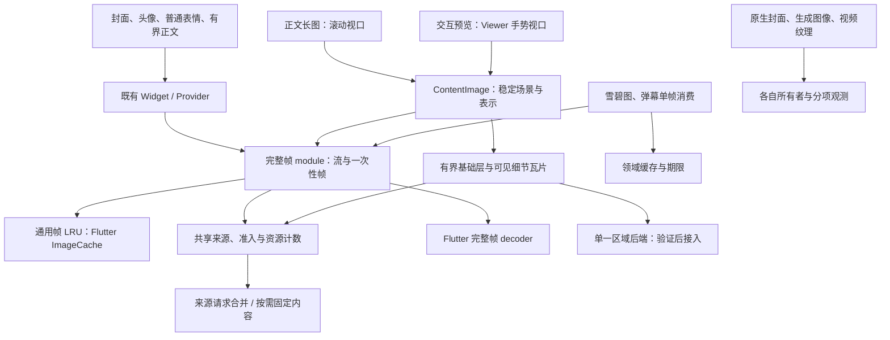

# 图片加载与预览设计稿

设计日期：2026-11-12，第三版；实施更新：2026-11-14。场景依据见[五类场景与解码路径调查](image-usage-audit.md)。本文说明架构和扩展约束；实际入口、预算和平台能力以[图片模块说明](../../lib/common/widgets/image/README.md)为准，命令与验证结果见[测试契约](../../test/common/widgets/image/CONTRACTS.md)。实验中的 libvips 不属于生产依赖。

## 本轮实施状态

Provider、一次性帧和后续动画取帧已共用解码准入。封面按真实尺寸采样，本地附件、DecorationImage、HTML CSS 图片标记、雪碧图和弹幕已接入；通知封面通过现有插件配置为 512×512，其原生成本仍待设备验证。普通图片表情已改用惰性网格，文字和混合历史保留原布局。

正文、私信与 Gallery 共用 ContentImage。加载与动画许可独立，Viewer 使用稳定源坐标。Windows Gallery 已启用 WIC JPEG/PNG、libwebp 静态 WebP CPU 区域后端，包含快照租约、有界基础层、合并可见区域、输出计费和关闭排空。普通正文、Android 及其他平台仍走完整帧；尚无跨 surface 同区域去重。

当前共享区域输出预算为 128MiB；通用会话默认 16MiB、基础层 4MiB，Windows Gallery 使用 48MiB 会话、最多 32MiB 基础层。预算不约束格式内部全部工作区，也不约束完整帧回退的峰值。

弹幕一次性消费者合并编码文件请求，各自创建 codec，尚无第二套全局像素 LRU。重复静态表情的解码成本、其他设备及完整应用长期性能仍需对照。2026-11-13 的 207 项统一回归通过（Flutter 3.47.5，23 秒）；后续原生回归、性能取舍和未验证范围集中记录在测试契约与模块说明中。

## 设计决定

图片实现分为完整帧、内容显示和共享资源三部分。普通卡片、头像和表情保留 `NetworkImgLayer`、`CachedImage`、`CachedImageProvider`；正文阅读和交互预览通过 `ContentImage.network/file` 提供来源与视口。页面负责业务交互，内部会话管理 codec、快照与区域图像。

空间表示分为完整帧和静态区域，动画是完整帧的时间行为。雪碧图、弹幕栅格、视频交接和原生通知封面保留各自的期限、缓存及所有权。六类合成图片用于画质验收。

以下为设计时的依赖关系；其中区域后端现已在 Windows Gallery 接入。



| 方案 | 调用方责任 | 取舍 |
| --- | --- | --- |
| 全部调用改用 `open/update/dispose` | 每处图片管理会话 | 扩大普通图片迁移范围，影响 Provider 兼容性 |
| 公开内容租约、帧请求和瓦片批次 | 页面处理异步请求与交接 | 资源管理分散到业务层 |
| 保留 Provider，内容 surface 内管理会话 | 普通调用沿用入口，正文和查看器提供视口 | 采用；区域显示可独立于 GalleryViewer 使用 |

## 五类场景的显示契约

场景决定显示需求。`ImageType.avatar/emote/def` 还承担挂件等外观配置，不能用作解码算法枚举。

| 场景 | 入口与表示 | 显示要求 |
| --- | --- | --- |
| 封面、头像、挂件 | 既有 Widget / Provider，完整帧 | 按布局、有效 DPR、BoxFit 和源比例采样，保留动画及透明边界 |
| 常见正文图片/GIF | 裁剪网格走完整帧；阅读图片用 ContentImage | 保留可读细节和动画。区域阅读是扩展目标，当前正文仍走完整帧 |
| 普通表情 | 行内 Widget、惰性网格、tooltip/dialog | 保留动画、行高及放大语义，只加载可见及有限邻域；文字表情用 Text |
| 点击预览 | ContentImage + Viewer，完整帧或静态区域 | 本地与网络行为一致；邻页预加载与当前页动画分开；Live Photo 视频归播放器 |
| 其他 | 一次性帧、矢量、生成图像、原生 adapter | 雪碧图与弹幕明确单帧语义；SVG 保持矢量；截图、通知和视频纹理由领域管理 |

完整帧通过 `applyBoxFit` 的源矩形和显示矩形计算物理采样密度。未知源尺寸取自实际 decoder，避免每个头像增加预探测 codec；尺寸向足够采样的一侧归档，减少窗口微调产生的近似缓存键。低分辨率源不生成没有新增细节的高分辨率缓存。

CDN adapter 保留 URL、请求头、裁剪和动画格式语义。预览与正文需取得足够质量的来源，已裁掉的封面内容无法恢复。下载、分享和上传沿用原件路径。

## 调用与内部 interface

普通图片保留构造参数、相等性、缓存键及 `loadImage(key, decode)`。ContentImage 管理表示选择、占位和错误，正文与 Viewer 共用其会话；`SourceModel` 和 Live Photo 沿用原行为，无需额外的 `PreviewImage` 转发层。

内部契约示意如下，值类型名称以源码为准：

```dart
abstract interface class ContentSession
    implements ValueListenable<ContentState> {
  void update(ContentDemand demand);
  void dispose();
  Future<void> get drained;
}
```

`ContentDemand` 包含可见源矩形、物理采样比例、加载许可和动画许可。adapter 从当前页、邻页或正文可见范围推导优先级。`ContentState` 表达场景代次、真实尺寸及加载、绘制、失败状态；强内容版本仅用于区域路径。

会话同步建立，异步取得来源和元信息。`update` 保存最新需求，合并同一绘制周期内的变化，避免每个手势事件都排队解码。元信息未就绪时也保留最新需求。

共享 runtime 随 Flutter binding 存活，在 Provider 实际加载时解析。测试可注入隔离 runtime，`const` 构造、现有 `cacheManager` 和 decoder callback 保持有效；runtime 和 callback 身份不进入图片键。

### 加载、动画和可见性

`ImageLoadingScope(enabled: true)` 与 `TickerMode(enabled: false)` 允许截图树取得静态画面。页面失活、滚动离屏、邻页预取和静态导出分别表达需求。共享帧流聚合所有消费者：一个仍需动画时，另一个隐藏不暂停整个流；最后需求离开后按缓存和无监听规则回收。

正文布局按方向归一化后的原图比例计算高度，可见源矩形取祖先 viewport/clip 的有效交集；Viewer 从手势变换计算。仅对需要区域显示或动画暂停的内容跟踪变化，滚动通知合并处理，静态头像沿用 Flutter 生命周期。

普通图片表情使用惰性行或网格，保留间距和交互。直播表情面板与预览已有 builder，继续约束邻域保留。Tooltip 和放大 dialog 独立持有需求，关闭后归还，普通表情继续播放动画。

### 一次性帧

完整帧模块提供一次性解码入口，和 Provider 共用来源、解码实现、准入及取消规则，交付调用者拥有的 `ui.Image`。领域消费者负责后续 clone/dispose 和缓存。

- 雪碧图保持原 sheet 坐标，以及 PreviewImageCache 的请求合并、clone 和 3 项/24MiB 预算；缩放或裁剪后必须同步坐标。
- 弹幕固定取第 0 帧，随后关闭 codec，保留队列期限、候选和字节配额，缓存命中行为也需验证。
- 排队任务可取消；已启动任务保留名额到真实结束，取消后的输出由解码模块释放。长期缓存已交付图像不占解码名额。

UI 帧流执行框架传入的 `ImageDecoderCallback`；一次性消费者通过自己的入口注入测试 decoder。

## 内容版本与来源

普通 Provider 先用磁盘缓存并允许后台刷新，按 cache manager 和实际 URL 合并请求，不增加常规复制、哈希或预探测。扩展来源合并时，键还需包含会改变响应字节的请求上下文；请求头和账号信息保留在内部。

`SourceKey` 表示请求来源，场景代次标识当前展示，`SourceVersion` 固定确切字节。URL、路径、mtime 和长度只能辅助失效判断，不能充当强内容版本。

完整帧由一个 decoder 消费编码输入，复用现有来源与帧缓存。需要预探测的后端应将准备输入移交实际 decoder；缓存命中时使用该 completer 的真实元信息并释放未使用输入。原始尺寸和方向作为无 native 资源的伴随元信息保存。无法复用的探测和读取成本须纳入验收。

多次读取的区域路径使用自有磁盘快照；只有来源 adapter 能保证字节不可变时，才可省去复制：

1. 网络复用文件请求，本地读取用户文件；流式复制到独占临时文件，关闭后发布。
2. 每份快照分配不复用的版本并由租约固定，不要求全文件哈希或跨重启去重。
3. 同源活动会话共享正在创建或已发布的快照，最后租约结束后失效。后台刷新只影响后续会话。
4. 本地复制前后检查变化并有限重试；外部并发写入仍可能失败，不承诺文件系统级原子快照。发布后仅读自有文件，保留用户原文件。
5. 元信息、基础层和细节读取同一快照。其他 URL 的缩略占位不算同版本像素，`SourceModel` 尺寸仅作布局提示。

会话与已启动任务分别持有租约。在途输入保留到原生工作结束；静态 codec 取帧后关闭，动画 codec 按帧流生命周期持有。长期离屏停止区域需求，受压时可释放整个会话，恢复后布局保持稳定。

快照位于 `image_preview_v1`，由模块单独统计和清理。`clearLibraryCache` 调用模块入口，通用目录扫描排除它；活动条目标记待删，最后租约释放后执行，启动时清理遗留临时文件。区域缓存不得扩展为无界的长期 URL 快照库。

## 两种表示与画质

| 表示 | 使用范围 | 画质要求 |
| --- | --- | --- |
| 完整帧 | 普通有界图片、动画及明确的能力回退 | 缩略图按显示采样；可读正文和预览保留细节，不统一套固定 1MP 上限 |
| 静态区域 | 已验证后端支持的局部阅读或预览 | 同版本基础层覆盖全图，按物理比例补可见细节及有限邻域，最细层保留原图采样 |

缩放更新视口、层级和优先级。能力允许时会话保持所选表示；Windows Gallery 遇动画、方向、格式或容量边界时，先排空区域工作，再明确回退完整帧。损坏和进程错误保留错误状态，防止失败后意外触发大图完整解码。

基础层在细节尚未就绪、换层或新区域暴露时提供覆盖，来源缩略图只作临时占位。基础层、旧细节、新细节、在途输出和待绘制退役批次一起计费；预算不足先停止预取、淘汰空闲并逐步交接。透明区域采用互斥裁剪，避免基础与细节重复混合。

通用协议的瓦片核心边长为 512 层像素，保留至少一圈采样重叠，并读取降采样滤波所需邻域。各块须等价于统一全局坐标下的层图，绘制裁到核心区域；文字、棋盘格、透明边缘和接缝需像素对照。Windows 后端合并可见矩形，减少重复区域解码。

成本估计包含源尺寸、动画依赖帧、原生工作区、保留图像和交接重叠。`width × height × 4` 仅表示输出像素，无法证明 PNG 缩小解码或大动画的总峰值。完整帧分级、跨 surface 区域去重及空闲瓦片 LRU 尚待独立验证。

GIF/WebP 动画保留时序、循环和合成语义，当前没有静态瓦片方案可替代超大动画。后端扩展须明确报告能力不足，避免用首帧或降低画质掩盖限制。

## 资源所有权与缓存

UI 完整帧使用 Flutter `ImageCache` 作为通用像素 LRU，网络预览沿用 URL、manager 和尺寸键；本地文件保留显式失效语义，路径键不检测任意外部写入。雪碧图、弹幕栅格、视频交接及原生 Bitmap 缓存继续由领域管理。

区域图像由会话直接管理，不进入 ImageCache，也不使用私有版本化 Provider。键为 `(SourceVersion, level, coordinates, samplingSpec)`。快照、原生输出、显示 clone 和框架引用分别记录；同一像素的多个句柄不能重复计算为分配。既有 64 MiB 完整帧缓存预算仅约束对应 LRU。

`obtainKey` 只返回纯值键；命中缓存时 loader 可能不执行，键也没有释放回调。准备输入由请求或会话持有，实际加载时交给 loader，命中、取消或失败时由原所有者释放。需要复用预探测输入的后端可用 prepared-frame adapter，同时执行传入的 decoder callback。

| 资源 | 所有者 | 释放条件 |
| --- | --- | --- |
| 区域快照文件 | 源仓库；会话和任务各持租约 | 最后租约释放；活动清理延后 |
| buffer / codec | 对应 decoder 工作 | 交接或失败恰好释放一次，原生在途工作结束后关闭 |
| 完整帧 `ui.Image` | 经 `OwnedFrame.takeImage()` 交给 `ImageInfo` / completer | 按 Flutter clone/dispose 协议释放 |
| 基础层/瓦片像素 | entry 持唯一根句柄，缓存和绘制批次持租约 | 淘汰缓存引用后，最后引用释放根句柄 |
| 绘制批次 | 内容 surface | 换批后按绘制周期归还；detach/dispose 同样收尾 |
| 一次性帧 | 交付前归解码模块，交付后归消费者 | 取消或未交付时模块释放，交付后按领域生命周期释放 |
| 生成图像与原生图片 | 截图、栅格、播放器或插件 | 完成、替换或销毁时释放，单独观测 |

区域逐块绘制，不拼成整图。借用句柄仅用于租约有效期内的同步绘制；异步截图在首次 `await` 前取得独立句柄或租约，结束后释放，结果不回流预览缓存。

离屏导出按明确矩形和物理分辨率准备内容。长图整幅导出须有界分段生成或限制输出；该能力尚未实现时报告限制。小分享卡片保留原行为，直接保存原文件不经过栅格导出。

listener、`RawImage` 和渲染层各持引用，句柄释放也可能晚于 retained picture/display list 或 GPU 回收。诊断区分模块持有、框架交付及框架缓存。

## 取消、代次与排空

会话状态为 `opening → ready / failed → disposed → drained`；活动与暂停单独表达。局部细节失败可保留已就绪画面并报告错误。

- `dispose()` 幂等，同步撤销交付、移除排队工作、停止定时器并开始清理，随后停止 listener 通知。
- 在途原生任务保留名额到真实完成，迟到输出由模块释放。取消不突破并发上限，也不当作加载错误。
- 发布校验会话与场景代次，区域结果另校验内容版本和视口代次。旧视口结果可在预算内缓存，不能替换当前画面；旧清理回调不移除同键的新 entry。
- 同会话内相同 tile key 合并在途工作；一个消费者取消只撤销其需求，最后需求离开才取消未开始的工作。跨 surface 去重尚未实现。
- 动画保持循环次数、单 codec 单次在途取帧、暂停恢复、末帧、无监听回收和 keepAlive 规则。加载遵循 `ImageLoadingScope`，动画遵循 TickerMode 与可见性。
- 来源、元信息和解码错误保留 cause/stack，失败清除失效缓存与占用名额。

`drained` 表示停止交付，独占且失去需求的任务已结束，自身租约和未交付资源已释放。它不等待其他会话、共享缓存或框架引用，也不保证 GPU、驱动池和 WC 归零。UI 的 `State.dispose` 不等待；测试和显式 teardown 可以等待，runtime 关闭还需等待全部原生任务。

## 准入与可观测性

原生解码并发为 2，UI 初始帧每绘制周期交付预算为 6 MiB。创建 codec 到首次交付共用准入，后续动画每次取帧重新取得名额。交付预算只限制交付节奏。

可见帧、基础层和细节优先于预取，同级按 owner 轮转并提升久候工作的优先级。不可切分重预处理最多占一个名额，可切分工作按层或区域归还；原生任务一旦开始便无法靠优先级抢占。

弹幕在排队和启动前检查期限；其 maxTasks=4 不扩大共享原生并发。一次性帧不使用 UI 交付预算。截图等待嵌套图片时不持有解码名额，生成栅格和通知原生工作单独统计。

快照复制单独串行限流，不占像素解码名额。复制、探测和预处理仍需测量主 isolate 占用，重计算交给适当原生线程或 worker。

共享区域输出在分配前预留，取消后保留到真实完成，覆盖可见、空闲、在途及待退役图像。显示引用有效期间不能强制淘汰；空间不足时停预取、回收空闲，再等待交接或选择粗层。常量留在模块内部，实际数值见实施状态。

常态在订阅、分配和释放边界更新低成本计数：排队/在途、取消后在途、快照租约、区域估计字节、预留及清理状态。共享资源标记身份，避免重复求和；诊断录制时补充代次、耗时和快照，不常开全局图像 hook 或堆栈采集，也不输出源 URL 和本地路径。

原生解码工作区与 GPU 单列估计，未知项保留未知。通知封面还需核对插件 Bitmap LRU、当前通知及媒体会话引用；快捷方式、WebView、原生裁剪和视频纹理分别归外部资源域。

## Viewer 的稳定坐标

[ContentViewer](../../lib/common/widgets/image_viewer/content_viewer.dart) 与 [ContentImage](../../lib/common/widgets/image/content_image.dart) 使用方向归一化后的 `sourceSize` 固定场景。占位、完整帧和区域层绘制到同一几何中，解码尺寸只影响采样，保留长图初始定位、最大缩放与翻页/退出拖拽规则。

原图到初始布局映射为 `B`，手势矩阵为 `M`，可见源矩形由 `(M × B)` 的逆变换取得。物理采样采用当前 view 的有效 DPR，兼容自定义 binding 的逻辑坐标。

捏合、滚轮、双击、惯性和容器变化统一发出变换通知，按绘制周期合并。换层不重置手势，窗口变化保留源焦点并按边界收敛；占位交接和 LOD 更新复用同一 Viewer 子树。

## 文件安排与实施顺序

| 位置 | 职责 |
| --- | --- |
| `image/cached_image.dart` 与 `image/src/frame_*` | Provider、Widget、一次性帧、ImageCache 协作及帧生命周期 |
| `image/image_resources.dart` 与相关 `image/src/` | 来源、快照、调度和计数 |
| `image/content_image.dart` 与 `image/src/content_*` | 来源装配、会话、稳定场景、占位/错误及区域调度绘制 |
| `image_viewer/viewer.dart` | 场景坐标、变换通知与手势 |
| `image_viewer/gallery_viewer.dart` 与正文容器 | 视口适配和业务交互 |
| `pages/emote/`、雪碧图、弹幕及音频入口 | 领域需求、一次性帧及原生尺寸 |
| `utils/cache_manager.dart` | 快照统计与活动租约安全清理 |

ImageCache 动画观察和私有 completer 留在同一 Dart library，可用 `part` 拆分。来源与 decoder 在外部依赖边界注入，调度、版本比较和淘汰保留内部实现。Provider 执行传入的 `ImageDecoderCallback`，兼容自身尺寸和外层 `ResizeImage`，避免叠加两个 `getTargetSize`。

生命周期、场景需求和稳定坐标已接入，区域后端目前启用在 Windows Gallery。下一阶段按设备证据扩展正文或其他平台，再决定空闲 LRU、预取及完整帧分级。

区域后端须报告元信息、能力、层级映射、估计工作区，并提供有界输出和 close/drain。受控 adapter 验证协议；真实格式、冷启动、画质和打包需独立验证。

## 验收

| 范围 | 核对内容 |
| --- | --- |
| 原调用兼容 | Provider/Widget、ImageCache、取消恢复、真实动画 WebP 和 decoder callback |
| 封面与本地文件 | BoxFit、宽高比、有效 DPR、实际像素、请求头、CDN 裁剪与原件保存 |
| 正文与预览 | 专栏 HTML/长图、消息、动态/评论网格，点击前后细节，离屏与隐藏许可，CSS 图片准入 |
| 普通表情 | 文字和图片、评论/动态/私信/输入/直播聊天、惰性网格、tooltip/dialog 释放、共享动画 |
| 领域消费者 | 弹幕首帧/期限，雪碧图坐标及 3 项/24MiB 缓存，视频交接、投币首帧、通知封面 |
| 截图与导出 | 加载与动画许可、导出矩形完整性、等待子图时的名额及生成输出释放 |
| 来源与版本 | 缓存复用、探测输入复用、同路径换内容、后台刷新、复制中变化、活动清理 |
| 几何与绘制 | 换层保持位置、全部变换入口、窗口焦点、透明边缘和接缝 |
| 所有权 | 迟到结果释放、共享隔离、真实并发、交接计费和排空范围 |
| 调度与失败 | 预处理隔离、owner 轮转、等待老化、预算不足处理、错误后保持区域失败语义 |
| 画质与动画 | 一般、高分辨率、GIF、长图、超高/低分辨率、动画 WebP、透明和方向样本 |
| 设备性能 | Windows/Android 冷热首屏、预处理、连续手势、取消退出、重复循环、帧时间、内存和磁盘 |

对照固定来源、物理视口、滤镜和冷热缓存，记录分布与噪声，并测量冷启动至退出的真实峰值。原设计候选门槛为中位耗时回退不超过 5%、p95 不超过 10%。本机 Windows 压力组在降峰的同时超出延迟门槛，当前取舍及最终源码差异见模块说明；其他设备仍待验收。

复用 `test/common/widgets/image/` 中 `image_lifecycle_test.dart`、`image_cache_lifecycle_test.dart`、`image_resume_inflight_test.dart`、`decode_budget_cancel_test.dart`、retained-layer 回归，以及 `test/plugin/pl_player/preview_image_cache_test.dart`、`test/pages/live_room/emote_danmaku_test.dart`，按变更补充入口和协议回归。

源码入口：[图片加载](../../lib/common/widgets/image/cached_image.dart)、[缓存配置](../../lib/common/widgets/scale_app.dart)、[预览入口](../../lib/common/widgets/image_viewer/gallery_viewer.dart)、[预览适配](../../lib/common/widgets/image_viewer/content_viewer.dart)、[内容状态](../../lib/common/widgets/image/content_image.dart)、[手势](../../lib/common/widgets/image_viewer/viewer.dart)、[缓存清理](../../lib/utils/cache_manager.dart)。命令见[构建与测试](build-and-test.md)，原始实验留在本地 `doc/dev/`。

## 架构判断的依据与适用范围

Provider 保留普通图片的框架生命周期，内容会话集中处理视口和区域表示，来源及取消规则由共享资源层统一。领域消费者继续控制自己的缓存和期限。更换区域后端只影响内部接口，无需页面管理瓦片或租约。

参考 `https://api.flutter.dev/flutter/painting/ImageCache-class.html` 的缓存接口，以及 `https://github.com/davemorrissey/subsampling-scale-image-view` 的基础层和可见细节覆盖。后者仅提供区域组织思路，其 Android 实现不代表本项目已具备对应平台能力。预算、区域尺寸和超大动画方案仍需按后端及设备验证。
