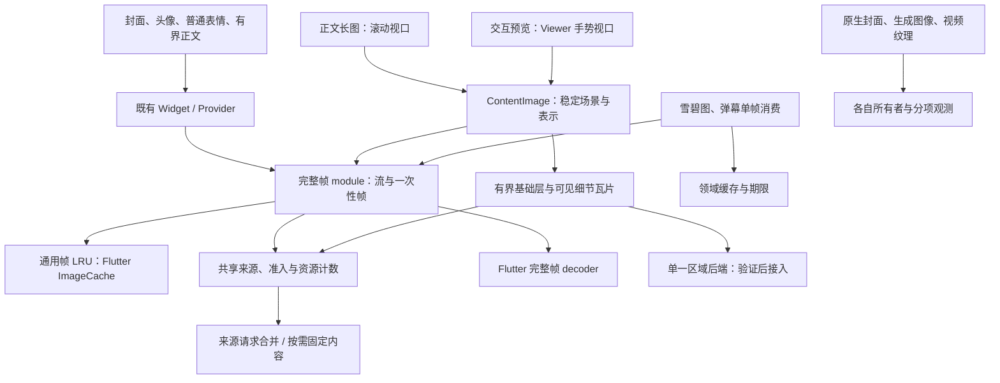

# 图片加载与预览设计稿

日期：2026-11-12。修订：第三版，依据[五类场景与解码路径调查](image-usage-audit.md)修订。状态：拟实施设计，尚未替换生产图片路径。本文规定下一轮重构的 interface、所有权与验收条件。区域解码后端尚未选定，实验中的 libvips 不属于生产依赖。

## 设计决定

采用三个按职责内聚的 module，以已有帧显示入口和一个按需内容 surface 服务不同场景，内部仅有两种空间表示：

- 封面、头像、普通表情和有界正文保留 `NetworkImgLayer`、`CachedImage`、`CachedImageProvider`；补齐已有直接 Provider 与本地文件的目标尺寸和生命周期。
- 新增 `ContentImage.network/file` adapter，供需要完整阅读的正文图片和交互查看器共用。正文提供滚动视口，Viewer 提供手势变换；同一个 surface 管理完整帧或区域表示。
- 完整帧 module 保留 Provider、动画调度与 Flutter 缓存协作，并提供内部一次性单帧 seam；内容 surface module 管理稳定场景、表示和瓦片；共享资源 module 负责来源、准入、取消与计数。
- 空间表示只有完整帧和静态瓦片。动画属于完整帧的时间行为；六类合成图片继续作为验收样本。
- 雪碧图、弹幕栅格、视频输出交接和原生通知封面保留领域所有者。可共享的帧解码接入共享准入，领域期限、缓存和原生实现分别维护。

本版修正第二版的范围遗漏：区域能力同时覆盖点击前的正文长图；普通表情与弹幕单帧消费分开；保留合理的领域缓存；加载、动画、可见性分开表达。继续保留第二版的按需快照、普通缓存身份、有界基础层和预处理隔离。三个 module 是 implementation 的内部组织，页面不管理 codec、快照或瓦片租约。



比较过三种 interface：

| 方案 | 调用方承担的知识 | 取舍 |
| --- | --- | --- |
| 全部调用改用 `open/update/dispose` | 所有图片调用管理会话 | 核心简洁，但扩大普通图片迁移范围，削弱既有 Provider 兼容性 |
| 对外公开内容租约、帧请求和瓦片批次 | 页面管理异步请求及资源交接 | 所有权显式，但把维护负担扩散到页面 |
| 保留 Provider，内容 surface 内管理会话 | 普通调用复用既有入口；正文/查看器提供来源和视口 | **采用**；帧、内容 surface、资源职责内聚，区域显示不依赖 GalleryViewer |

## 五类场景的显示契约

五类场景用来确定默认显示需求，不建立五套 decoder，也不把现有 `ImageType.avatar/emote/def` 当作算法枚举。后者包含挂件等外观用法，无法表达动画、可见区域或原生能力。

| 场景 | 入口与表示 | 需求和画质 |
| --- | --- | --- |
| 封面、头像、挂件 | 既有 Widget / Provider；完整帧 | 按实际布局、有效 DPR、BoxFit、源宽高比确定采样；保留动画与透明边界，不为普通卡片创建区域会话 |
| 常见正文图片/GIF | 裁剪网格继续完整帧；完整阅读图片使用 ContentImage | 小图直接帧显示；需要读取长图当前段或局部原细节时可选区域；动画保持帧流 |
| 普通表情 | 行内 Widget、惰性图片网格、tooltip/dialog；完整帧 | 保留动画、行高和放大语义；只对可见及有限邻域维持加载/动画需求；文字表情仍为 Text |
| 点击预览 | ContentImage + Viewer；完整帧或静态区域 | 原图坐标、交互与画质选择解耦；本地/网络一致；预加载邻页和当前页动画需求分开；Live Photo 视频仍由播放器管理 |
| 其他 | 一次性帧、矢量、生成图像与原生 adapter | 雪碧图和弹幕明确单帧语义；SVG 保持矢量；截图/视频交接/通知封面由对应领域所有者管理 |

完整帧目标使用 `applyBoxFit` 对应的源矩形和显示矩形推导所需物理采样密度，不能继续只以 `width <= height` 决定所有请求。已知来源尺寸可直接使用；未知尺寸复用实际 decoder 的元信息，不为每个头像增加一次 codec 或完整预解码。尺寸按内部有限档位归一，避免窗口微调产生大量近似缓存键，档位须向足够采样的一侧选择。

CDN 请求由来源 adapter 处理，保持实际 URL、必要请求头、裁剪和动画格式语义。它不能替不支持的源伪造区域访问，也不能从已裁掉内容的封面缩略图恢复原图。预览与可读正文按需要取得足够质量来源；下载、分享和上传继续使用原有原件路径。

## 调用与内部 interface

普通图片保留现有构造参数、相等性、缓存键和 `loadImage(key, decode)` seam。`ContentImage.network/file` 只迁移需要按内容阅读的入口，接受来源、布局和既有占位/错误参数，内部吸收选表示的复杂度。其内部内容会话供正文视口 adapter 与 Viewer adapter 共用，页面不直接持有租约。`SourceModel` 与 Live Photo 视频路径沿用现有行为；不再另增一层只供 GalleryViewer 转发的 `PreviewImage`。

内容 adapter 内使用以下 interface。代码仅示意契约，省略值类型构造器；业务页面不直接管理 session 或图像租约。

```dart
abstract interface class ContentSession
    implements ValueListenable<ContentState> {
  void update(ContentDemand demand);
  void dispose();
  Future<void> get drained;
}
```

`ContentDemand` 包含可见原图矩形、每个原图像素对应的物理采样比例、加载许可和动画许可。需求优先级由 adapter 的当前页/邻页/正文可见范围推导，不向页面暴露队列参数。`ContentState` 包含场景代次、真实尺寸、加载/可绘制/失败状态与供绘制 adapter 消费的不透明 presentation；强内容版本留在区域路径内部，不要求普通完整帧伪造一个文件版本。

内容 adapter 同步建立会话，异步取得来源和元信息，不再另建一个只有 `open` 的通用 pipeline interface。`update` 替换最新需求，合并同一绘制周期内的更新；不会为每次手势/滚动事件排一项解码。元信息未就绪时保存最新需求。

默认 runtime 在当前 Flutter binding 生命周期内共享，Provider 在实际加载时解析它，保持 `const` 构造与键语义。测试可装配隔离 runtime；现有 `cacheManager` 与 decoder callback 注入继续有效。不另增不可重置的进程级静态队列，也不把 runtime/callback 的对象身份塞入图片键。

### 加载、动画和可见性

加载许可与动画许可独立：现有 `ImageLoadingScope(enabled: true)` 加 `TickerMode(enabled: false)` 的截图树必须能取得可绘制帧而不播放动画。页面失活、滚动离屏、预取邻页和静态导出分别产生需求，不能压成一个 `active` 开关。

正文长图的布局高度来自方向归一化后的原图比例，滚动可见源矩形来自祖先 viewport/clip；Viewer 提供手势变换后的源矩形。只为需要区域显示或暂停动画的内容跟踪这些变化，在滚动容器内合并通知，避免为每个静态头像注册全局逐帧可见性扫描。未处于可见范围的长图不预取所有瓦片；跨多个 viewport 时取有效裁剪交集。

同一帧流被多处使用时聚合各使用者需求：只要一个可见使用者仍需动画，隐藏另一个不能暂停它。最后需求离开后取消尚未启动工作，并依既有缓存/无监听动画规则回收。纯静态图片沿用普通 Flutter 生命周期，不要求每处图片额外创建内容会话。

普通图片表情面板的 eager Wrap 改为惰性行/网格，保持原有间距、文字表情与交互；直播表情面板和表情包预览已使用 builder，重点核对保留范围。Tooltip 与表情放大 dialog 各持自己的需求，关闭后独立归还。不能通过统一只取首帧来掩盖离屏动画成本。

### 一次性帧

完整帧 module 内增加小型一次性解码 seam，输入编码来源与必要目标尺寸/帧模式，返回调用者拥有的 `ui.Image`。它和 Provider 共用来源、decoder implementation、准入与取消规则，不额外建立全局像素 LRU，也不要求领域消费者订阅 UI 动画流。

- 雪碧图使用原始 sheet 坐标，保持现有 PreviewImageCache 的合并、clone 和 3 项/24MiB 预算；不能套封面裁剪或任意缩放后仍用旧坐标。
- 弹幕图片明确为静态第 0 帧，交付后释放 codec，保留队列自己的期限、候选与字节配额。此处把当前“只取一次流回调”收敛为确定性首帧契约，缓存命中也须验收；普通表情仍播放动画。
- 排队时可取消；真实 codec/帧请求开始后保留准入至完成，取消后的输出由 module 释放。领域接管图像后负责 clone/dispose 与自身缓存，准入名额不因长期缓存图像而一直占用。

UI 帧流遵循框架 `ImageDecoderCallback`；一次性消费者在自己的 seam 注入测试 decoder。不得为统一 implementation 绕过 Provider 传入的 callback。

## 内容版本与来源

普通 Provider 继续使用当前“先用可用磁盘缓存，继续后台刷新”的语义，不增加每次加载都复制、哈希或预探测的成本。现有路径继续按 cache manager 与实际 URL 合并，不同画质 URL 不强行合并。扩展到其他消费者时，来源身份还须包括会改变响应字节的请求上下文；不能把不同请求头或账号来源仅因 URL 相同而合并。身份字段仅在内部使用，不输出敏感请求头。

区分三个概念：`SourceKey` 表示请求来源，场景代次表示当前展示，`SourceVersion` 才表示固定的确切字节。URL、文件路径与 stat 信息可以帮助缓存失效，但不能充当强内容版本。

完整帧只经一个 decoder 消费编码输入，沿用现有来源缓存与帧缓存语义，不强制增加磁盘快照。内容 surface 需要预探测时，准备出的编码输入由一次受控请求持有，并交给实际完整帧 decoder；不再独立读取两份文件或预解码两次像素。缓存命中则以命中 completer 对应的真实元信息为准，立即释放未使用的准备结果。原始尺寸/方向作为不持有 native 资源的伴随元信息保存在帧流中，不能拿缩小后的像素尺寸或刚刷新的文件头描述旧缓存帧。不能复用准备结果的后端必须把额外读取/探测成本纳入验收，不把“预探测免费”当成假设。

只有需要多次独立读取的区域路径，或来源明确要求固定版本时，才建立强内容租约。当前 cache manager 尚不提供可验证的不可变文件租约，因此区域路径首版采用 module 自有磁盘快照；未来只有来源 adapter 证明可 pin 不变字节时才可省略复制：

1. 网络预览复用来源请求；本地预览读取用户文件。按流复制到独占临时文件，完成并关闭后才发布快照，避免把整份压缩文件读入 Dart 堆。
2. 首版给每个已发布快照分配不复用的 `SourceVersion`，并以租约固定其文件。版本代表这份确切快照，不使用 URL、路径、mtime 或长度冒充内容身份；不要求全文件哈希或跨重启去重。
3. 同时打开同一来源的区域 surface 可合并正在进行的快照创建，已有活动快照可由同时在场的正文和查看器共同取得租约；只在最后租约结束后失效，不扩展成长期 URL→快照缓存。会话保持原版本，后台网络刷新只影响后续取得的内容；普通整帧预览不产生新版本键。
4. 本地文件复制前后检查变化，异常时有限重试。对外部并发写入不承诺文件系统级原子快照；复制结果经元信息/解码校验，失败按来源错误交付。发布后只读自有快照，用户原文件不被修改或删除。
5. 区域预览的元信息、基础层与所有细节瓦片读同一个快照。来源缩略占位可以来自另一个 URL，但不被当成同版本像素证据。`SourceModel` 的尺寸只作占位提示；方向、动画和尺寸以实际内容与已验证的 decoder 能力为准。

区域会话持有一个强内容租约；实际启动的区域任务另持独立租约。正文长图长期离屏时停止区域需求并退役细节；会话保留基础层/快照也计入预算，受压时可整体释放，重新进入视口重新建立会话且不改变正文布局。完整帧请求只在读取和 decoder 所需期间持有自己的输入资源。排队任务失去最后需求后直接取消；在途任务的输入保留到原生工作结束，静态 codec 交付后及时关闭，动画 codec 沿自身生命周期持有。

快照与区域预处理产物放在独立的 `image_preview_v1` 缓存目录，不混入 cache manager 的单文件键。缓存统计显式包含它；`clearLibraryCache` 先调用 module 清理入口，并在通用临时目录扫描中排除该目录。清理删除无租约条目，对仍活动的版本标记待删，最后一个租约结束后执行；不等待其他页面关闭。启动时清理上次进程遗留的孤立临时文件。磁盘配额与清理统计单独记录。

## 两种表示与画质

在元信息和实际后端能力就绪后提交表示选择；同一会话提交后保持不变。缩放只改变视口、瓦片层级和优先级，不在完整帧与瓦片之间来回切换。新内容版本建立新会话。

| 表示 | 选择依据 | 画质规则 |
| --- | --- | --- |
| 完整帧 | 有界普通图片、动画，以及峰值成本可接受的整图 | 普通缩略图按显示采样；可读正文和预览不能只套固定 1MP 上限。完整帧分级稍后单独验证 |
| 静态瓦片 | 正文阅读或交互预览需要局部访问、完整解码成本过高，且真实区域/预处理能力已通过验证 | 保留有界基础层；细节层保留原尺寸采样，按物理显示比例只加载可见区域及有限邻域 |

瓦片表示是“基础层 + 细节覆盖”。基础层可以是一张受控小图，也可以是一组较粗瓦片，必须由同版本输入经过已验证的有界路径产生。它在细节缺失、层级切换和新暴露区域提供覆盖；只在细节就绪后退役被替换的旧细节，避免一次换批造成空洞。来源缩略图可提前显示，但随后替换为同版本基础层，不被永久标记成原图质量。

基础层、旧细节、新细节和在途输出一起计费。预算不足先停止预取、保留基础层、逐块收敛，不同时保留两套完整细节层，也不为基础层偷偷完整解码原图。基础层的单独字节上限与首屏耗时纳入后端验收，不能依靠无限延迟旧批次释放维持画面。

成本模型使用来源尺寸、动画依赖帧、已验证的原生暂存估计、当前保留图像和交接重叠。输出 `width × height × 4` 只是一项像素估计，不能证明 PNG 缩小解码或超大动画的峰值可控。

保证细节依靠最细层原图采样与按视口加载，不能依靠固定 8MP/16MP 上限。低分辨率内容不为满足显示尺寸生成无新增细节的高分辨率缓存。首版以线性绘制为基线，选择不低于所需采样密度的可用层；超过原生分辨率仍可放大，但不会声称新增了原图细节。

瓦片核心边长暂定 512 层像素，绘制至少保留一圈层像素的采样重叠。后端额外读取其降采样滤波所需邻域，生成结果必须等价于统一全局坐标下的层图；不能各块独立缩小后直接拼接。绘制裁剪到核心区域，验证透明边缘、文字、棋盘格和接缝，最终尺寸以目标设备测量调整。

区域后端在提交表示前失败或不支持时，仅在完整帧成本模型已验证且允许时选择完整帧。提交瓦片表示后失败则保留可用结果并报告可重试错误；禁止暗中完整解码超大原图再裁剪。重新尝试可建立新会话，但同版本场景坐标可保留。

动画没有静态瓦片路径。普通 GIF/WebP 保留时序、循环和合成语义；超大动画若后端无法以可接受成本解码，仍存在能力缺口，不能以静态首帧或降低画质宣称已解决。该设计给出明确的受限/失败状态及能力扩展 seam，不在首版增加另一套动画格式后端。

当前没有已验证的生产区域后端。生命周期迁移阶段保持原有显示策略；后端验证通过后再启用新选择规则。对尚不能安全解码的来源，最终规则必须给出明确的受限/失败状态，不能把降低清晰度包装成完整画质。

## 资源所有权与缓存

通用 UI 完整帧只使用 Flutter `ImageCache` 作为可复用 LRU，不再创建并行的通用帧缓存。网络完整帧预览优先直接复用现有 Provider 及 URL/manager/尺寸键，不因打开查看器而改变缓存身份。本地完整帧进入共用的帧加载 implementation，保留文件来源的缓存与显式失效语义；不声称路径键能自动检测任意外部写入。

雪碧图的 PreviewImageCache、弹幕栅格缓存、视频交接图像和原生媒体 Bitmap 缓存各自保留所有者、键、配额与清理语义。共享层登记归属和实际解码，不接管这些领域的存活时间。单次解码缓存的像素根、显示 clone 和框架引用分开计数，不能把同一像素的多个句柄重复当成独立分配，也不能以领域缓存上限代替所有领域总量。

区域 surface 直接管理同版本基础层与细节瓦片；键为 `(SourceVersion, level, coordinates, samplingSpec)`，基础图使用对应的基础层标识。基础层与瓦片统一使用资源 entry/批次租约，完全计入区域工作集，不进入 ImageCache。第一版的私有版本化 Provider 因而删除。占位在基础层/完整帧可用后及时移除；已有缓存的 64 MiB 仍只约束对应 LRU，不是总图片内存上限。

`obtainKey` 不取得输入租约或持有准备结果：缓存命中可能不执行 loader，键也没有释放回调。拥有准备结果的请求/会话在 resolve 后明确选择移交给实际 loader，或在命中/取消后释放；创建 completer 时另取所需输入资源。

为复用预探测输入，帧加载层内部可使用 prepared-frame adapter：其 `obtainKey` 返回现有的纯值帧键，`loadImage` 将准备输入交给共用 loader 并执行传入的 decoder callback。准备结果仍由请求/会话拥有，缓存命中不执行 loader 时由该所有者释放；adapter 不创建新的内容版本或第二套帧缓存。

| 资源 | 所有者与交接 | 释放条件 |
| --- | --- | --- |
| 区域快照文件 | 源仓库；区域会话与在途任务分别持租约 | 最后租约释放后可删；活动清理延后执行 |
| buffer / codec | 帧或区域 decoder 工作 | 明确 buffer 交接，失败路径恰好释放一次；原生在途工作结束后关闭 codec |
| 完整帧 `ui.Image` | `OwnedFrame.takeImage()` 一次性交给 `ImageInfo` / completer | 后续遵循 Flutter clone/dispose 协议，module 不保留第二个像素根或 LRU |
| 基础层/瓦片像素 | 区域 entry 唯一根句柄；缓存与绘制批次持引用租约 | 淘汰只撤销缓存引用；最后引用释放根句柄 |
| 当前绘制批次 | 内容 surface 持有批次租约 | 换批后按绘制周期延后归还旧批次；detach/dispose 也需完成归还 |
| 一次性帧 | 帧 module 交付前拥有，交付后由雪碧图/弹幕消费者接管 | 未交付或取消后 module 释放；已交付按领域生命周期释放 |
| 生成图像与原生图片 | 截图、弹幕栅格、播放器或插件自己的所有者 | 按领域完成/替换/销毁释放，单独观测 |

瓦片直接逐块绘制，不拼成完整 `ui.Image`。借用瓦片句柄只用于租约有效期内的同步绘制；异步截图/导出须在首次 `await` 前取得独立拥有的句柄或租约，并在结束后释放。导出图片不回流为预览常驻缓存。

离屏截图要按明确的导出矩形与目标物理分辨率取得内容，不能沿用屏幕可见瓦片而漏掉正文其他部分。小型分享卡片保留原行为；整幅长图导出需要有界分段生成或明确输出限制，尚未实现时报告能力不足，不能偷偷拼出一张无限大的中间图。直接保存/分享原文件不要求经过此栅格导出路径。

Flutter listener、`RawImage` 和渲染层会持有各自的图像引用；仅靠 Provider 无法追踪所有框架克隆。图片句柄释放也不等于 retained picture/display list 或 GPU 立即释放。诊断区分 module 持有、框架交付和框架缓存，不以句柄数冒充独立像素分配数。

## 取消、代次与排空

会话状态为：`opening → ready / failed → disposed → drained`。活动/暂停属于独立需求状态。补充瓦片失败可保持 ready 与已有画面，同时发布局部错误。

- `dispose()` 幂等，同步撤销交付资格、移除排队工作、停止定时器并启动清理；之后不再通知会话 listener。
- 已启动的原生请求继续占用准入额度。迟到结果由 module 释放，实际 Future 结束后才归还名额，不能通过快速取消突破真实并发。
- 结果发布同时校验会话/场景代次，区域结果还校验强内容版本和视口代次。旧视口结果可在预算内进入相同内容的缓存，不能替换当前视口；旧 entry 的清理回调也不能移除同键替代品。
- 相同 tile key 合并在途工作；取消一个使用者只撤销其需求，最后使用者离开才取消尚未开始的共享工作。
- 动画保留循环次数、单 codec 单次在途取帧、暂停恢复与末帧语义；无监听动画回收及显式 keepAlive 沿用现有契约。加载许可遵循 `ImageLoadingScope`，动画许可遵循 TickerMode 与可见性，保留暂停页面截图的显式加载能力。
- 取消不是加载错误；来源、元信息和 decoder 错误保留 cause/stack，失败不留下失效缓存或永久占用的名额。

`drained` 仅表示该会话退出已收尾：不会再交付，其独占且已失去需求的任务结束，未交付资源和自身租约已释放。仍被其他会话、共享缓存或框架持有的资源不在等待范围；不能承诺 GPU、驱动池或 WC 归零。UI 的 `State.dispose` 不等待它，测试与显式 teardown 可等待；runtime 关闭另需等待全部原生任务。

## 准入与可观测性

首版保留已有两项控制：解码准入名额为 2，初始帧每绘制周期交付预算为 6 MiB。当前创建 codec 到初次交付共用准入，后续动画取帧也会重新取得名额；后者不是只限首帧并发。交付预算不等于解码或驻留内存限制。

共享调度器采用有界的优先队列，不把所有工作塞进一条 FIFO。当前可见帧、基础层与可见细节优先，预取最低；同级轮转并对等待工作提升优先级，防止一个会话垄断或长期饥饿。区域建塔等不可切分长计算最多占一个解码名额，为普通帧保留另一个；可切分工作以层/瓦片为调度单位释放名额。已启动原生任务不能靠优先级切换伪装成可抢占。

弹幕期限在排队和启动前检查，过期移除且不进入昂贵工作；其本地 maxTasks=4 不是放大共享原生并发的许可。一次性帧交付不使用 UI 初始帧的绘制预算。截图等待嵌套图片加载时不持有像素解码名额，避免导出任务把名额占满后反过来等待自身子图；生成栅格和原生通知也不伪装成已被 Dart codec 队列控制。

快照复制是单独限流的文件 I/O，首版最多一个复制任务，不占用像素解码名额，但其磁盘和缓冲成本仍计入资源统计。先测复制、元信息探测与区域预处理的主 isolate 占用，确保重工作在合适的原生线程/worker 中执行；异步函数本身不等于不会阻塞 UI。

区域阶段新增进程内统一的可控瓦片工作集，暂以 64 MiB 像素估计作为调参起点，包含可见、空闲、待退役批次与在途输出预留。显示引用不能靠 LRU 淘汰强行失效；空间不足先取消预取、淘汰空闲，再等待交接或选择较粗层。首版可只保留活动批次，不必立即增加空闲 LRU。该数字与完整帧 ImageCache 的预算分别展示，不能声称加总后就是进程上限。

原生解码工作区与 GPU 成本只能按已验证后端估计，单列并记录未知项。准入在分配前预留可控输出，取消后到真实完成前保留预留；瓦片尺寸需小于单次可交付额度，避免大块永久饥饿。调参常量留在 module 内，不暴露为页面开关。

常态只维护低成本计数：按通用帧、正文/预览区域、雪碧图、弹幕、导出及原生域登记所有者，记录排队/在途、取消后在途、快照租约、瓦片估计字节、输出预留及清理状态。订阅/分配/释放时更新，不逐帧扫描全缓存；共享输出标注共享身份，归属统计不重复加总。诊断录制时再输出代次、耗时和分项快照；沿用诊断脱敏，不常开全局图像 hook 或堆栈采集。源 URL 和本地路径不作为常态明文诊断键。

Android 通知封面单独配置合理的物理目标尺寸，核对插件 Bitmap LRU、当前通知及媒体会话引用；现有未设置 downscale 的路径可能完整解码。优先使用已有插件配置完成尺寸限制，再用设备证据决定是否调整原生缓存或补充轻量统计。快捷方式图标、WebView、原生裁剪和视频纹理分别列为外部资源域，不把未知原生/GPU 字节填写为零。

## Viewer 的稳定坐标

当前 `image_viewer/image.dart` 从已解码图尺寸计算 `childSize`，而 `Viewer.didUpdateWidget` 在尺寸变化时重置手势。引入 LOD 前必须先解除这项耦合。

场景尺寸固定为内容方向归一化后的 `sourceSize`。占位、完整帧和各层瓦片绘制到同一场景；解码像素只影响采样，不改变场景几何。保留现有长图初始定位、最大缩放与翻页/退出拖拽规则。

由原图到初始布局的映射 `B` 和手势矩阵 `M` 计算场景到视口的变换；可见源矩形由 `(M × B)` 的逆变换得到。物理采样比例使用当前 view 的有效 DPR，与项目自定义 binding 的逻辑坐标保持一致，避免重复乘系统 DPR。

捏合、滚轮、双击、惯性与容器变化统一经过变换通知点，并按绘制周期合并需求。完整帧升级或瓦片替换不重置手势；容器变化保留源坐标焦点并按新边界收敛。占位切换复用同一个 `Viewer`，元信息就绪后的 LOD 更新不得另建手势子树。

## 文件安排与实施顺序

以下路径为拟新增位置。共享 implementation 和不依赖交互的内容 surface 集中在 `lib/common/widgets/image/`，预览交互集中在 `image_viewer/`；不把页面状态放进全局 module。

| 位置 | 职责 |
| --- | --- |
| `image/cached_image.dart` 与 `image/src/frame_*` | 完整帧 module：原导入入口、Provider、Widget、一次性帧、ImageCache 协作与帧生命周期 |
| `image/image_resources.dart` 与相关 `image/src/` | 共享资源 module：来源请求、按需快照、有界调度与低成本计数；不管理手势或动画时序 |
| `image/content_image.dart` 与 `image/src/content_*` | 内容 surface module：来源装配、session、稳定场景、占位/错误及区域调度/绘制；完整帧复用已有 adapter |
| `image_viewer/viewer.dart` | 稳定场景坐标、统一变换通知与手势 |
| `image_viewer/gallery_viewer.dart` 与正文容器 | 仅适配手势视口、滚动视口和业务交互，不再各自实现解码策略 |
| `pages/emote/`、播放器雪碧图、弹幕及音频配置入口 | 保留领域行为，接入正确需求/一次性帧/原生尺寸，不引入第二套通用 runtime |
| `utils/cache_manager.dart` | 图片快照目录统计与活动租约安全的清理联动 |

`ImageCache` 动画观察与 completer 的私有协作留在同一 Dart library，可用 `part` 拆分 implementation，避免为了跨文件访问公开 decoder 状态。仅在实际外部依赖 seam 注入来源与 decoder adapter；调度、版本比较和淘汰不各自包装成转发 interface。

完整帧 adapter 必须执行框架传入的 `ImageDecoderCallback`；不能从 runtime 绕过它固定调用另一 decoder。保留现有 Provider 自带尺寸或外层 `ResizeImage` 控制尺寸的合法组合，不叠加两个 `getTargetSize`；不以 callback identity 去重 codec，也不为普通 Provider 新增预探测 codec。

1. **收拢生命周期并补齐来源。** 提取现有帧所有权、来源请求与调度，保持 Provider 行为；接入本地完整帧和内部一次性帧，复用网络、雪碧图及弹幕回归。直接 Provider/DecorationImage 明确目标尺寸和生命周期；为 HTML CSS 图片增加可替换图片构建 seam，接入同一完整帧路径。此步不启用区域依赖。
2. **修正场景需求。** 普通图片表情网格惰性化，区分加载和动画需求；保留文字表情及 tooltip/dialog。补齐本地附件/封面目标尺寸；通过既有插件配置约束 Android 通知封面并独立测量，避免把这些工作藏进查看器重构。
3. **建立内容 surface 与稳定坐标。** 先以完整帧接入正文及查看器，分别验证滚动/手势/截图 demand；整帧继续复用缓存，不为所有内容复制文件。核对重复打开、元信息交接、占位移除和 Live Photo。
4. **验证并接入一条区域路径。** 按需实现快照及清理联动；将直接区域输出与有界流式预处理作为候选能力，选定通过 Windows/Android 验证的一个 implementation，接入基础层/细节层与公平调度。先验证正文长图和预览超大图，再逐步启用；完成依赖及许可登记。
5. **按数据增加优化。** 在相同 interface 上测量后，再决定空闲瓦片 LRU、预取及完整帧分级；不同时增加多套格式后端。

区域 seam 至少报告真实元信息、能力、层级映射、估计工作区，并提供有界输出与明确的 close/drain 语义。完整解码后裁剪不满足有界区域能力。尚无生产 implementation 的部分只用受控测试 adapter 验证协议，不宣称已证明真实格式或性能。

## 验收

| 行为轴 | 最小验收 |
| --- | --- |
| 原调用兼容 | 现有 Provider/Widget 生命周期、ImageCache、取消、恢复和真实动画 WebP 回归通过；保留 decoder callback 注入 |
| 封面与本地文件 | 各 BoxFit/宽高比/有效 DPR 的实际像素足够；本地封面/附件不再仅约束布局；请求头、CDN 裁剪与原件保存语义不变 |
| 正文与预览 | 专栏 HTML/结构化长图、消息长图、动态/评论网格，点击前后均核对细节；滚动离屏和隐藏路由分别测量；HTML CSS 图片不绕过准入 |
| 普通表情 | 文字/图片分开，评论/动态/私信/输入/直播聊天正常；惰性网格、tooltip、dialog 关闭归还；共享动画一方隐藏不影响另一方 |
| 领域消费者 | 弹幕静态第 0 帧和超时释放、雪碧图坐标及 3 项/24MiB 缓存、视频交接、投币动画首帧触发关系均保持正确；原生通知封面单独验证 |
| 截图与导出 | 加载开启而动画关闭时仍可绘制；区域内容按导出矩形准备，不漏段；等待子图不占解码名额；生成输出离开后释放 |
| 来源与版本 | 普通整帧命中复用原缓存，预探测不造成两次像素解码；区域同路径换内容、新旧网络缓存和读取中变化不混版；清理与活跃快照/在途任务并发安全 |
| 几何与绘制 | 同版本换分辨率/层级不改变缩放和位置；所有变换入口更新视口；调整窗口保留焦点；瓦片边缘像素对照 |
| 所有权 | 晚到 codec/frame/tile 不交付且释放一次；共享使用者互不破坏；取消后的真实并发不超额；排空不等待外部框架资源 |
| 预算与失败 | 基础层、新旧细节、输出预留与待退役批次一起计费；换层/拖动不因替换产生空洞；区域失败不暗中完整解码 |
| 调度隔离 | 长预处理不占满普通解码名额；多会话轮转；持续手势不让后台工作永久饥饿；取消后仍遵守真实并发 |
| 画质与动画 | 一般、普通高分辨率、GIF、长图、超高分辨率、低分辨率样本；增加动画 WebP、透明边界与带方向信息样本；比较实际帧、裁剪和显示采样 |
| 目标设备性能 | Windows、Android 的冷/热首屏、建塔、连续缩放/拖动、取消、退出与重复循环；同时记录帧时间、进程内存、受控资源和磁盘 |

验收采用相同源、物理视口、滤镜和冷/热缓存条件。一般图片加载与拖动性能以当前版本为基线，先按中位耗时回退不超过 5%、p95 不超过 10% 设候选门槛；同时记录噪声与样本分布，异常先复测定位。大图还必须核对从冷启动到退出的真实峰值，不能只拿已建好瓦片后的数字证明收益。数值是发布前待测门槛，不是已有性能保证。

复用 `test/common/widgets/image/` 下 `image_lifecycle_test.dart`、`image_cache_lifecycle_test.dart`、`image_resume_inflight_test.dart`、`decode_budget_cancel_test.dart` 与 retained-layer 回归，以及 `test/plugin/pl_player/preview_image_cache_test.dart`、`test/pages/live_room/emote_danmaku_test.dart`。新测试覆盖新 interface 承诺，避免重复复制一套旧 implementation 测试。生产区域后端还需真实像素与打包验证，受控 adapter 不替代设备验证。

当前源码参考：[图片加载](../../lib/common/widgets/image/cached_image.dart)、[缓存配置](../../lib/common/widgets/scale_app.dart)、[预览入口](../../lib/common/widgets/image_viewer/gallery_viewer.dart)、[预览图像状态](../../lib/common/widgets/image_viewer/image.dart)、[手势](../../lib/common/widgets/image_viewer/viewer.dart)、[缓存清理](../../lib/utils/cache_manager.dart)。构建命令见[构建与测试](build-and-test.md)。合成实验与设备原始资料继续保存在本地 `doc/dev/`，不作为已经实现的产品说明。

## 架构判断的依据与适用范围

这版是完成当前源码场景调查后的首选架构，判断范围为本项目、现有 Flutter 体系与跨 Windows/Android 的维护成本：

- **改动集中。** 普通卡片和表情复用已测试 Provider；正文与预览共用区域 surface，修复一次可覆盖点击前后，不把租约和瓦片知识交给页面。
- **按真实差异划分。** 完整帧与区域是空间表示，动画是时间行为；单帧消费者有小而明确的 seam。五类场景不复制五套 decoder，SVG/生成图像/原生封面也不硬塞进位图预览。
- **所有权能闭合。** 通用缓存、领域缓存、原生任务、框架引用分别归属；取消/迟到/交接的规则一致，已有雪碧图和弹幕语义得以保留。
- **常规成本可控。** 小图不复制快照、不额外预解码、不逐帧全局扫描；只为实际需要的长图/动画建立视口需求，区域后端可在内部替换。

相比“每场景一套策略类”，此方案减少重复来源/取消/缓存规则；相比“所有图片强制进入一个会话管理器”，它保留普通 Flutter 生命周期；相比“只改查看器”，它覆盖正文长图和一次性解码绕行。优点来自具体调用关系与责任收敛，性能仍须在相同输出要求下验证。

复核参考了 Flutter 的 ImageCache interface 及 Subsampling Scale Image View 的基础层/可见细节覆盖实现说明。前者支持保留现有按键复用的完整帧路径；后者支持区域表示中的渐进覆盖安排，但其 Android 实现不证明本项目的跨平台后端已可用。来源为 `https://api.flutter.dev/flutter/painting/ImageCache-class.html`、`https://github.com/davemorrissey/subsampling-scale-image-view`。

我认为这是当前证据下最合适的结构方案；尚不能称为已经证明的全局性能最优实现。区域后端、tile 尺寸、预算与超大动画能力仍须验证。保留这些选择在内部，按设备验收调整；若后端不能同时满足冷启动、工作集与画质要求，在内部 seam 更换 implementation，无需再修改页面调用和 Viewer 手势协议。
