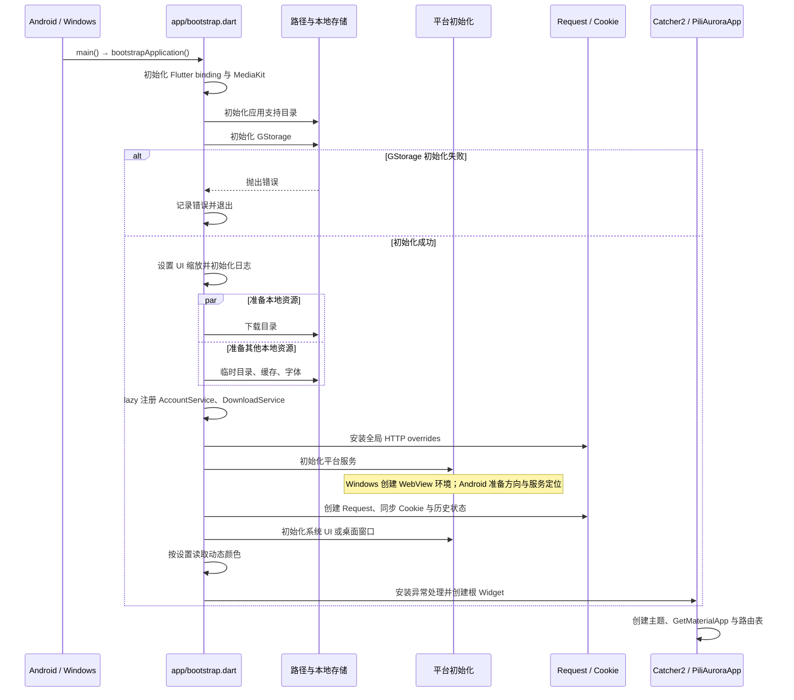
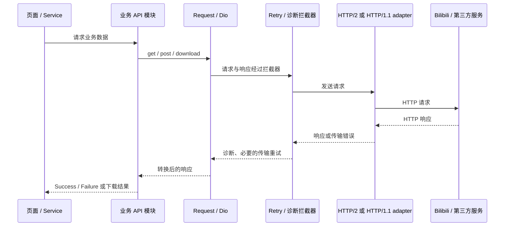
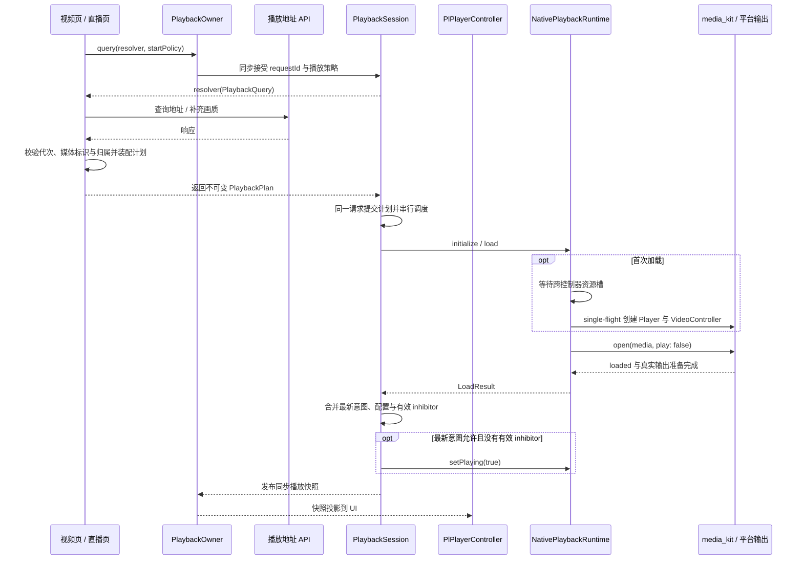
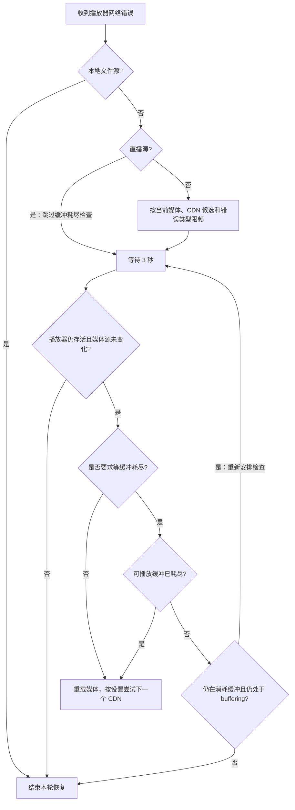
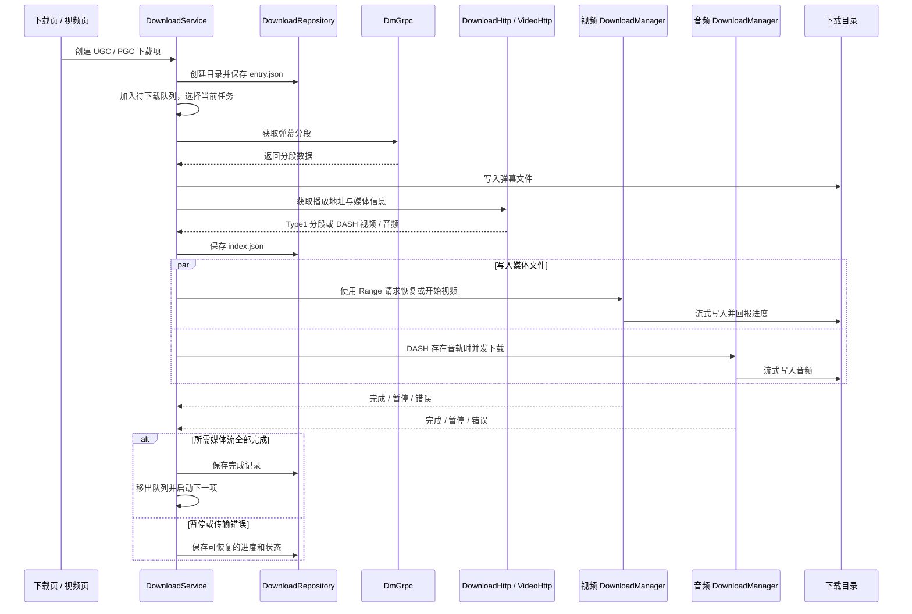
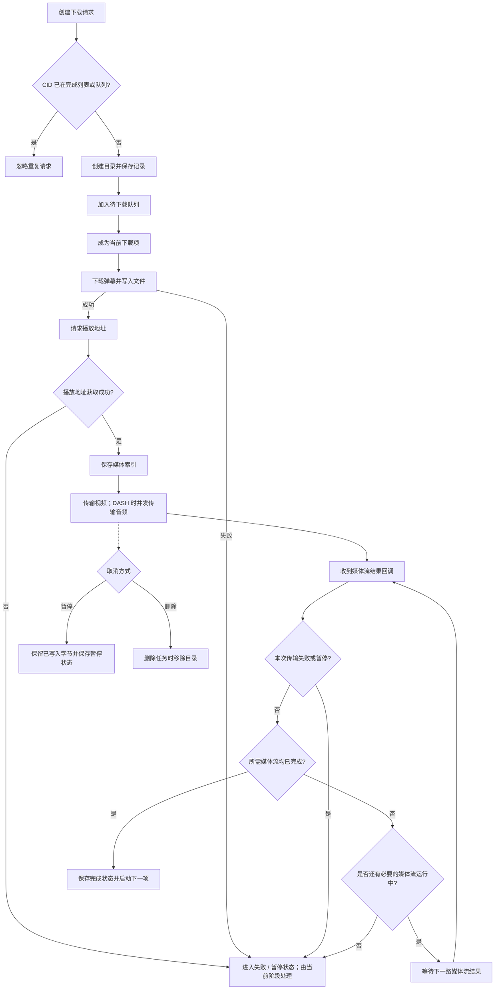
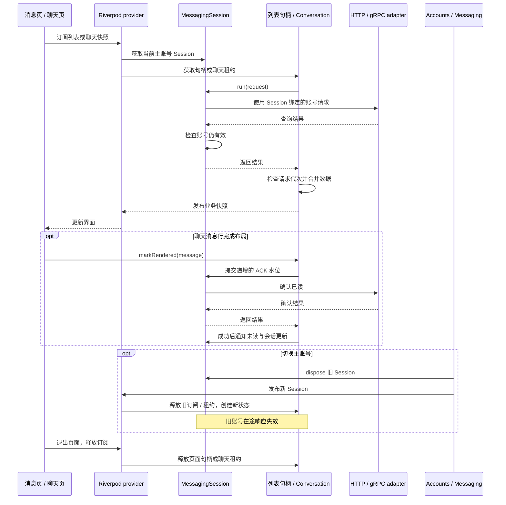
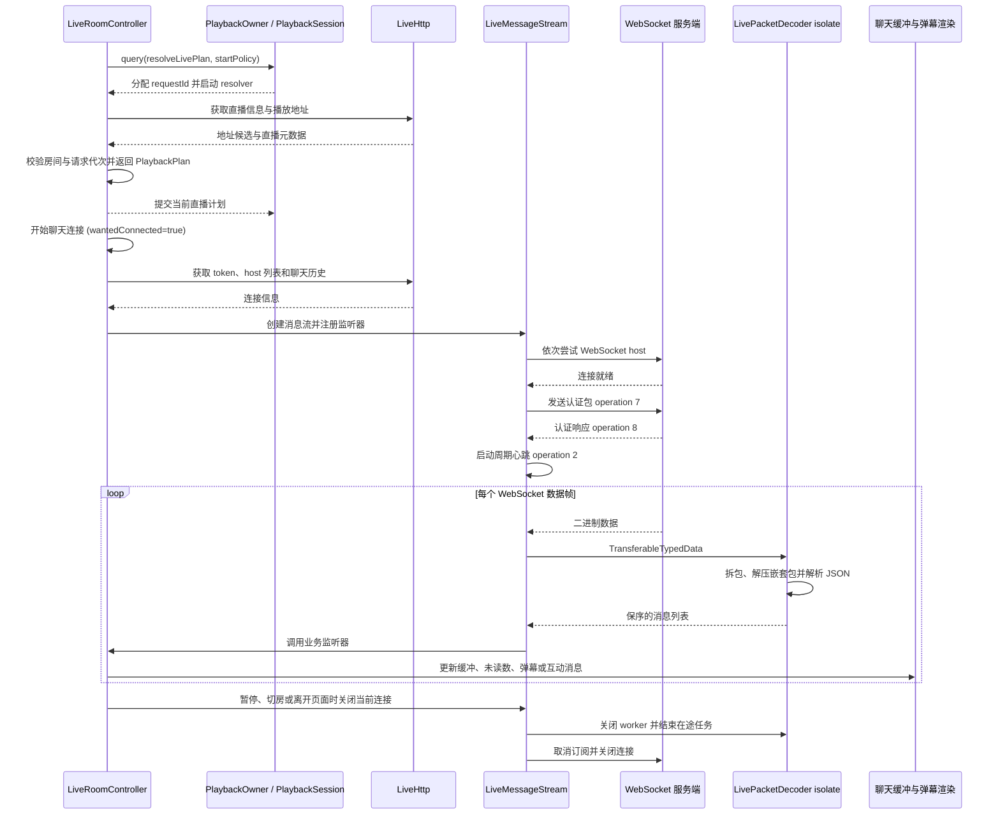

# 运行流程图

## 应用启动

`main.dart` 调用 `bootstrapApplication()`。主窗口的 Windows Cookie 同步会读取 WebView 环境，因此该环境要先于 `Request.setCookie()` 初始化。下面的时序描述主窗口启动。

`GStorage` 初始化失败时，应用记录错误后退出。下载路径、临时目录、缓存和字体并行准备，`AccountService` 与 `DownloadService` 通过 `lazyPut` 延迟创建。实现见 [`bootstrap.dart`](../lib/app/bootstrap.dart)、[`platform_setup.dart`](../lib/app/platform_setup.dart) 和 [`app.dart`](../lib/app/app.dart)。

Windows 独立播放窗口使用同一可执行文件的子进程入口，先连接主窗口获取播放请求和存储快照，再以 `GStorage.init(memorySnapshot: ...)` 初始化。它跳过主窗口的平台服务、WebView Cookie 同步和历史同步，使用独立缓存目录。生命周期见 [`desktop_playback_windows.dart`](../lib/services/desktop_playback_windows.dart) 与[播放窗口说明](windows-playback-windows.md)。

## HTTP 请求

业务 API 使用 `Request` 创建的 Dio 客户端。HTTP/2 开启时配置 HTTP/1.1 fallback；重试、诊断和压缩响应转换由请求层处理。

`Request.get()` 和 `Request.post()` 会把 `DioException` 转成含错误消息的 `Response`，调用层仍需检查业务响应。重试条件见 [`retry_interceptor.dart`](../lib/http/retry_interceptor.dart)。

`_CustomHttpOverrides` 默认验证 TLS 证书；仅当 `Pref.badCertificateCallback` 显式开启时接受无效证书。HTTP/1.1、HTTP/2 与回退适配器共用该设置，Debug 构建沿用相同规则。

## 播放器切源与网络恢复

### 请求、切源与页面归属

视频页与直播页各自持有一个 `PlaybackOwner`。最近激活的 owner 拥有控制权；路由返回时重新激活原 owner，页面释放 owner 不会影响其他页面或仍持有后台媒体租约的播放。所有者关闭后，如果没有其他 owner 或租约，会话开始关闭；跨控制器运行时槽会一直保留到旧 Player 的 `released` 完成。

页面装配不可变 `PlaybackPlan`，其中包含业务内容键、来源候选与选中索引、时间线、起播/重载位置和已捕获配置。内容键使用视频/分集/直播间等业务标识，不使用 URL。新查询通过 `owner.query` 同步接受 requestId 和起播策略，再在队列外查询地址；解析器只返回计划，由会话内部提交一次。相同内容重新解析保留当前播放意图与最新配置。视频的画质、编码、独立音轨选择仍由 `VideoPlaybackSource` 和页面业务逻辑完成。

查询、计划加载、暂停/播放、跳转、倍速、音量、音轨、解码器和 shader 都经 owner 命令进入 `PlaybackSession`。`PlaybackSnapshot` 同步给新订阅者当前完整状态，之后提供最新快照；`PlPlayerController` 将其投影到 UI。进度和视频帧继续通过专用流处理，字幕、播放历史、直播消息和弹幕等副作用留在页面适配层。

旧 owner 的查询和命令在失去控制权时失效。会话在每次 await 和原生返回后核对请求代次；已经发出的原生操作保留在运行时串行链中。快速切源复用原生资源。关闭时先停止接受新命令，再按有界时限执行卸载、输出释放和 Player dispose；资源槽只有在 `Player.released` 后才放开，避免旧运行时和新运行时同时占用原生播放器。

### 原生加载、首帧与释放

1. 会话接受 load 后冻结计划并分配 loadId；运行时初始化等待资源槽，再用同一个输出代次创建 Player 和 VideoController。
2. Android 在 `on_preloaded` 阶段读取唯一视频轨并准备 Surface，使 Surface 在解码器创建前可用；FILE_LOADED 继续核对实际选轨、几何、PAR 和旋转。无法复用预挂载输出时，才进入加载后的受控挂接回退。
3. Windows 在输出线程创建 render context 和 ANGLE 资源，按目标显示器完成初始尺寸提交。独立播放窗口收到稳定纹理后才交接声音并结束窗口启动等待。
4. 原生文件加载和输出准备完成后，会话进入 ready；页面加载过渡仍等待实际视频帧呈现，纯音频或明确无视频的媒体走无纹理路径。
5. 输出就绪前出现 EOF、断流或无效几何时，加载按对应类别及时失败。直播几何等待有 5 秒上限，且不能超过请求剩余预算。
6. shutdown 先停止接受新命令，再排空已接受操作、卸载文件、解除 VO/wid、等待原生输出释放回执并销毁 Player。运行时 `released` 完成后才释放跨控制器资源槽。

加载阶段、输出证据和释放耗时可从播放器诊断的 `runtime.initialize.*`、`media.output.preloaded`、`media.startup.failed` 与 `runtime.shutdown.*` 区分。首帧出现、纹理像素、MediaCodec/GPU 和音频输出仍需目标设备验证。

实现见 [`playback_session.dart`](../lib/plugin/pl_player/playback/playback_session.dart)、[`native_playback_runtime.dart`](../lib/plugin/pl_player/playback/native_playback_runtime.dart) 和 [`playback_source.dart`](../lib/pages/video/playback_source.dart)。

### 媒体时钟与跳转确认

点播弹幕使用独立的只读媒体时钟。原生位置、播放状态等通知触发后台属性采样，运行时确认采样仍属于当前媒体后发布锚点。显示端按锚点的单调时间和实际速率求值；暂停、缓冲或播放状态变化时冻结或重新建立锚点，倍速切换保留运动连续性。采样合并及在途结果失效由 `NativeMediaClockSampling` 管理，原生句柄销毁前等待读取完成。

seek 命令携带 `seekSequence`，经运行时传给 media_kit 的 `observationId`。提交后暂停发布普通媒体锚点，等待与当前 Player、加载绑定和跳转序号匹配的原生完成通知，再更新连续性并恢复采样。下一次 seek 的就绪等待在会话命令执行器之外进行，使暂停、切源和关闭仍可推进；新请求或所有者失效会取消旧等待。

实现见 [`media_clock.dart`](../lib/plugin/pl_player/playback/media_clock.dart)、[`native_media_clock_sampling.dart`](../lib/plugin/pl_player/playback/native_media_clock_sampling.dart) 和 media_kit 的 [`seek_observation.dart`](../third_party/media_kit/lib/src/player/native/player/seek_observation.dart)。对应回归位于 `test/plugin/pl_player/playback/` 的 `media_clock_test.dart`、`native_media_clock_test.dart`、`native_media_clock_sampling_test.dart`、`native_seek_observation_test.dart` 和 `playback_session_test.dart`。

### 网络错误恢复

连接中断和媒体读取截断进入该链；HTTP 403 不按 CDN 故障重试。`utils/playback_network_recovery.dart` 识别网络读取错误，[`playback/network_recovery.dart`](../lib/plugin/pl_player/playback/network_recovery.dart) 管理当前媒体的计时器、限频与缓冲等待。切源会释放恢复状态，当前媒体的错误风暴合并为一个计时器，终止读取可升级已有的缓冲等待。分离音视频的读取错误先保留主视频剩余缓存，耗尽后再重载；主媒体的播放与缓存同时恢复推进时，可以取消本轮网络重载。加载队列繁忙时继续等待，保留本轮恢复机会。

网络源的音频读取或解码错误同时交给 [`playback/audio_recovery.dart`](../lib/plugin/pl_player/playback/audio_recovery.dart)。它先观察 2 秒，音频时间戳继续推进且与播放位置同步时保持播放；缓存中的音频仍有效时也不提前重载。确认音频停滞后，先异步重载当前外部音轨，mpv 将其同步到视频位置；确认仍未恢复时，再通过加载队列执行一次保留位置与播放意图的整段重载，按多 CDN 设置选择后备地址。听视频或没有外部音轨的来源直接使用整段重载兜底。

每轮最多尝试一次音轨重连和一次整段重载；命令回执后留出 8 秒有效播放观察期，依据音频时钟推进与同步确认恢复，重复错误不延长等待。确认失声时显示“正在恢复声音”，预算耗尽后显示点击重试。原生音频健康信号也可启动观察，因此后续没有新错误日志时仍能接管。音频连续健康 30 秒后重新开放预算；终止读取后保留观察直到显式重连，残余缓存超过 30 秒仍会继续监视。

暂停、缓冲、静音、拖动或接近片尾时让出音轨恢复，恢复播放后继续检查遗留故障，暂停与等待不消耗时钟恢复观察期。切源和关闭使旧观察失效；mpv 的外部音轨异步命令绑定原生播放生命周期，不占用页面加载队列。观察依据音频时间戳而非音量，内容本身的无声片段不会触发恢复。主视频缓冲触发恢复检查；缓存时间超前但缓冲状态与位置连续停滞时仍可重连。网络重载在途时合并后续错误，HTTP 403 取消待执行的重试。

已选视频轨的原生进度与输出消费证据持续失效时，界面显示“正在恢复画面”，等待 3 秒后仍停滞才重载；恢复出帧或暂停、seek 后取消本轮画面恢复。该路径复用会话的自动恢复预算。

播放器界面在加载期间保留计划中的续播位置与时长，忽略卸载、open 的临时位置和零时长；ready 后再交接到当前位置。新视频从自身的起播位置开始展示，同一视频重载保持原进度。显示位置和实际原生时钟分别处理，加载中的临时零值不写入页面播放历史。

“手动播放前预加载视频”在关闭自动播放时提前加载当前媒体并保持暂停，点击播放直接继续。关闭预加载时先解析来源，正常结束查询并等待点击；期间点击播放会更新当前查询的加载决策和播放意图。预加载状态按实际媒体就绪情况判断，设置本身不作为已经加载的证据。

点播重载保留位置，直播重载不设置起始位置。切换画质、音质或重新解析已加载媒体时保留位置与播放意图。两者先暂停加载，完成后检查媒体有效性与最新播放意图；加载期间用户主动暂停时不会被恢复操作覆盖。开启多 CDN 时，直播仅使用当前协议、格式和编码提供的候选地址。

Windows 在确定硬件或软件后端后注册纹理，硬件初始化失败时先释放 GL 资源再进入软件路径。Android 保留既有 MediaCodec、Surface 与解码恢复实现，GPU、MediaCodec、Surface 行为和帧率在目标设备验证。

Windows 超分切换通过 owner 的 shader 配置命令进入会话调度；运行时在需要时暂停视频输出、重建渲染器、提交 shader 并恢复输出。释放顺序和首帧条件见[Windows 视频输出](windows-video-output.md#超分切换)。

## 下载

### 任务时序

下载记录由 `DownloadRepository` 持久化，`DownloadService` 维护待下载队列和当前任务，`DownloadManager` 负责单路媒体流。DASH 视频与音频可并发传输；任务只有在所需媒体流都完成后才标记完成。恢复时根据已有文件长度发送 Range 请求；暂停会保留已写入字节，删除则由服务移除对应目录。

### 任务状态

实现与测试：[`download_service.dart`](../lib/services/download/download_service.dart)、[`download_repository.dart`](../lib/services/download/download_repository.dart)、[`download_manager.dart`](../lib/services/download/download_manager.dart)；`test/services/download/`。

## 账号消息与私信

消息页面沿用 GetX 路由，通过 Riverpod 获取当前主账号的 `MessagingSession` 和业务快照。未读概览、会话列表及聊天缓存由 Session 共享；分类消息句柄随页面订阅释放。状态所有权与协议入口见[消息模块](../lib/services/messaging/README.md)。

私信分享由 `PageUtils.pmShare` 获取当前 Session 的 `MessageSharing`，将它传入分享页；发送时从同一聊天缓存获取租约。发送文本、图片和分享共用该聊天的发送锁。分享卡片确认成功后才发送附言；消息发送请求成功或结果待确认时，重新查询时间线并废弃发送前的读取。网络层关闭消息写请求的自动重试，结果待确认时页面提示核对聊天记录。卡片与附言分别请求，部分成功的结果保留已发送信息。

聊天读取历史时保留表情映射，刷新使旧历史页失效；消息按稳定标识合并。ACK 失败后等待更高渲染水位或手动刷新重试。系统通知先展示查询结果，再异步确认已读，失败时保留数据和未读数。

## 直播消息与弹幕

视频播放和聊天使用独立连接。直播播放地址通过 owner 查询解析成计划并由会话提交；聊天连接另取连接信息。消息连接由 `wantedConnected` 和连接代次控制，token、历史、图片及回调必须匹配当前连接代次和房间。

每条连接复用一个解析 worker。`startLiveMsg` 同一时刻共用一次 token/history/连接建立；暂停、切房或离开页面会撤销连接意图并推进代次，使旧 HTTP 结果、连接回调和图片结果失效。直播页返回时先重绑状态监听与弹幕控制器，再释放路由 inhibitor；若当前实际播放，监听会接续消息与弹幕。关闭或 worker 异常会结束在途任务，损坏的数据包会被跳过。实现见 [`live_room/controller.dart`](../lib/pages/live_room/controller.dart)、[`live.dart`](../lib/services/live_stream/live.dart)、[`live_packet_decoder.dart`](../lib/services/live_stream/live_packet_decoder.dart) 和 [`live_packet.dart`](../lib/services/live_stream/live_packet.dart)，回归位于 `test/pages/live_room/controller_test.dart` 与 `test/services/live_stream/`。
