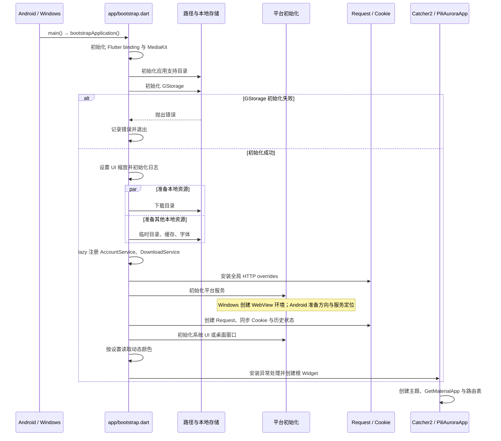
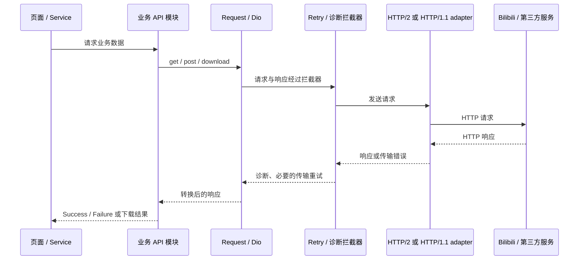
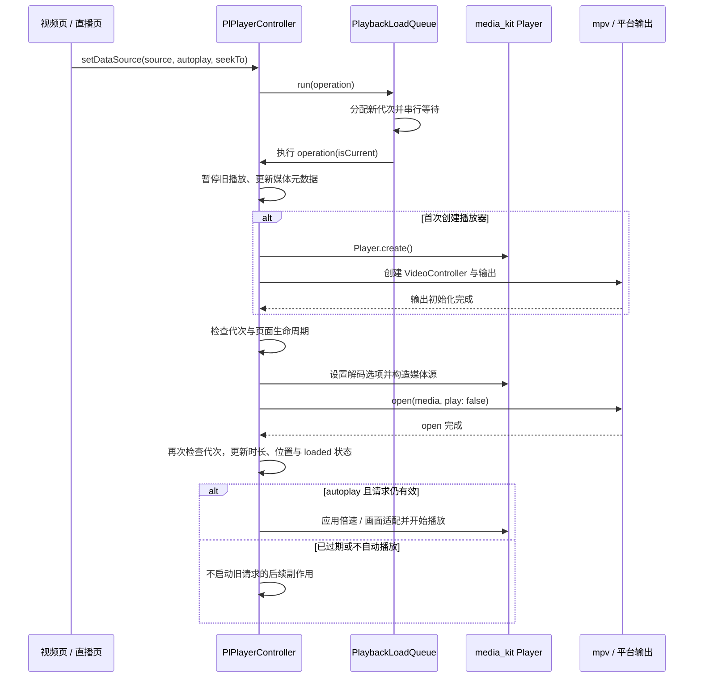
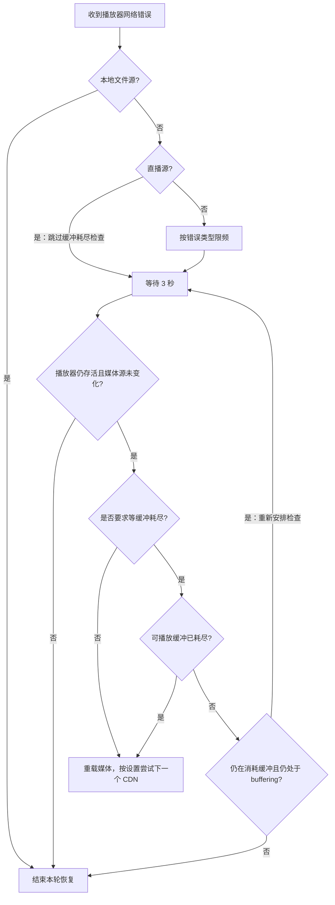
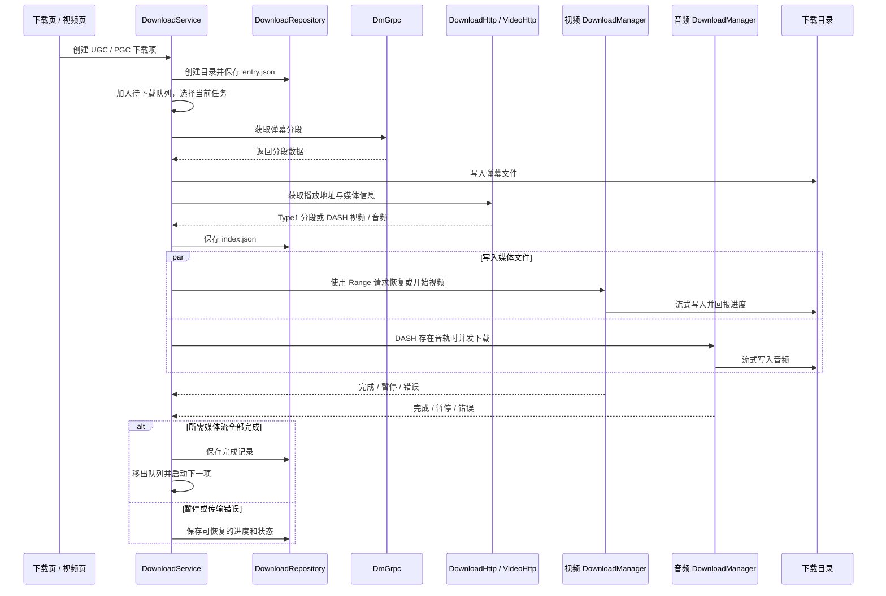
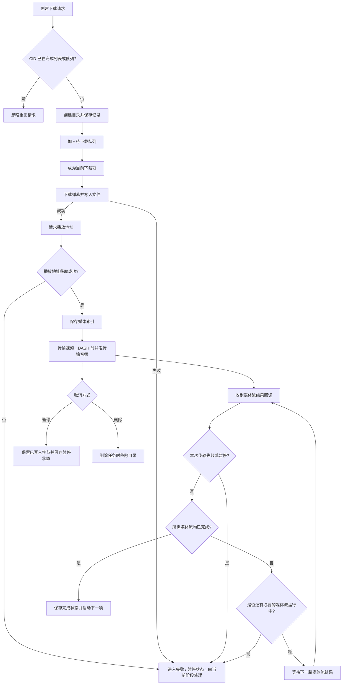
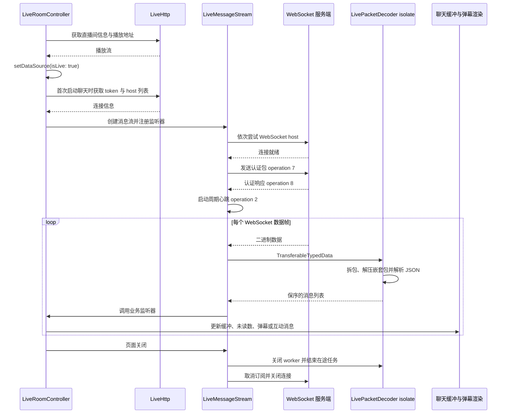

# 运行流程图

## 应用启动

`main.dart` 调用 `bootstrapApplication()`。Windows 的 Cookie 同步会读取 WebView 环境，因此该环境要先于 `Request.setCookie()` 初始化。

`GStorage` 初始化失败时，应用记录错误后退出。下载路径、临时目录、缓存和字体并行准备，`AccountService` 与 `DownloadService` 通过 `lazyPut` 延迟创建。实现见 [`bootstrap.dart`](../lib/app/bootstrap.dart)、[`platform_setup.dart`](../lib/app/platform_setup.dart) 和 [`app.dart`](../lib/app/app.dart)。

## HTTP 请求

业务 API 使用 `Request` 创建的 Dio 客户端。HTTP/2 开启时配置 HTTP/1.1 fallback；重试、诊断和压缩响应转换由请求层处理。

`Request.get()` 和 `Request.post()` 会把 `DioException` 转成含错误消息的 `Response`，调用层仍需检查业务响应。重试条件见 [`retry_interceptor.dart`](../lib/http/retry_interceptor.dart)。

`_CustomHttpOverrides` 在调试模式或 `Pref.badCertificateCallback` 开启时接受无效证书，此时 TLS 证书校验会降低。

## 播放器切源与网络恢复

### 切源时序

`setDataSource()` 将加载任务交给 `PlaybackLoadQueue`。队列按序执行，并用代次使旧任务停止后续副作用。已发出的原生操作不会被队列中断；操作返回后会检查代次并丢弃旧结果。

只有当前代次的加载失败会更新错误状态并写入诊断。实现见 [`controller.dart`](../lib/plugin/pl_player/controller.dart) 和 [`playback_load_queue.dart`](../lib/plugin/pl_player/utils/playback_load_queue.dart)。

### 网络错误恢复

只有可恢复的网络错误才进入该链；HTTP 403 不按 CDN 故障重试。`playback_network_recovery.dart` 识别错误，`PlPlayerController` 管理限频、缓冲检查和媒体重载。GPU、MediaCodec 与 Surface 恢复需在目标设备验证。

## 下载

### 任务时序

下载记录由 `DownloadRepository` 持久化，`DownloadService` 维护待下载队列和当前任务，`DownloadManager` 负责单路媒体流。DASH 视频与音频可并发传输；任务只有在所需媒体流都完成后才标记完成。恢复时根据已有文件长度发送 Range 请求；暂停会保留已写入字节，删除则由服务移除对应目录。

### 任务状态

实现与测试：[`download_service.dart`](../lib/services/download/download_service.dart)、[`download_repository.dart`](../lib/services/download/download_repository.dart)、[`download_manager.dart`](../lib/services/download/download_manager.dart)；`test/services/download/`。

## 直播消息与弹幕

视频播放和聊天使用独立连接。页面从 `LiveHttp` 获取播放地址；聊天另取连接信息，再由 WebSocket 接收弹幕和互动消息。

每条连接复用一个解析 worker。关闭或 worker 异常会结束在途任务；损坏的数据包会被跳过。实现见 [`live.dart`](../lib/services/live_stream/live.dart)、[`live_packet_decoder.dart`](../lib/services/live_stream/live_packet_decoder.dart) 和 [`live_packet.dart`](../lib/services/live_stream/live_packet.dart)，测试位于 `test/services/live_stream/`。
